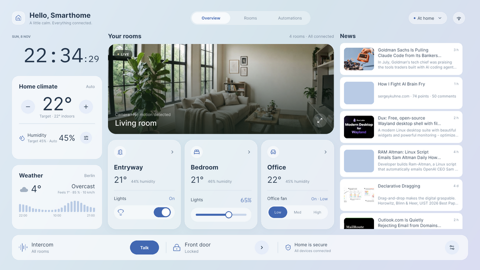
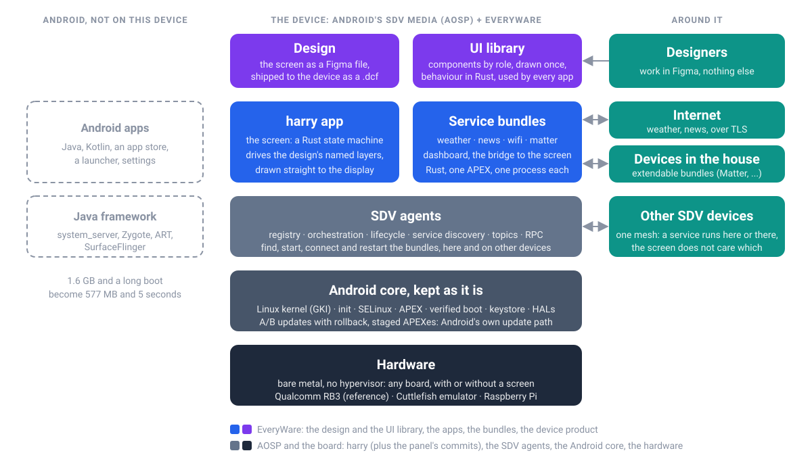
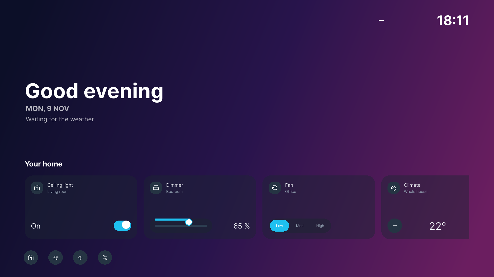
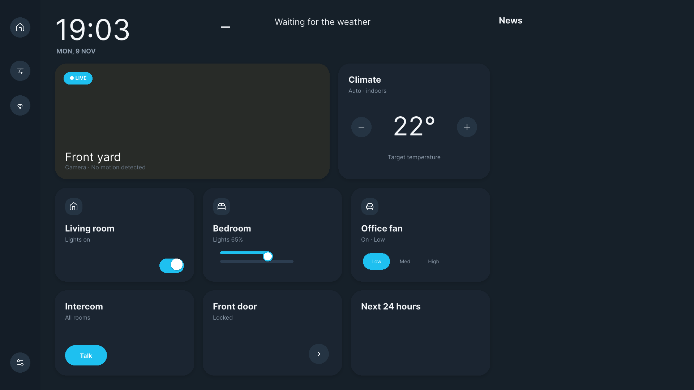
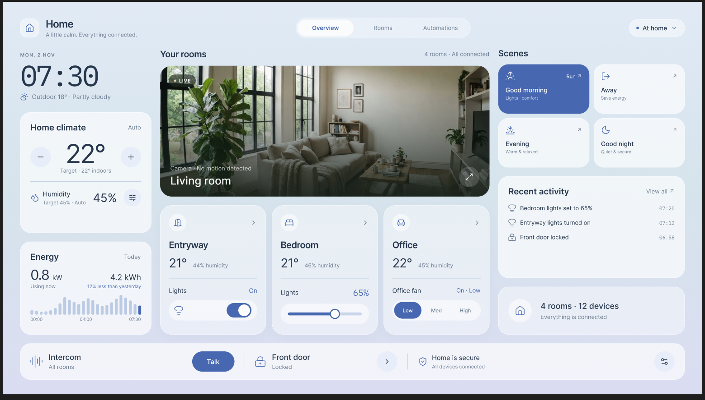

<p align="center">
  
</p>

<h1 align="center">SDV EveryWare</h1>

<p align="center">
  <b>Google's SDV Media on every embedded device, with and without a screen.</b><br>
  Not a new OS: Google's <a href="https://source.android.com/docs/automotive/sdv">AAOS SDV</a> taken out of the car, the cluster's safety monitoring off, a smart home's services on. Android without Java.
  A delightfully fast boot. A Figma design as the screen. Services in Rust. Updatable for years.
</p>

<p align="center">
  <a href="#why">Why</a> ·
  <a href="#what-you-get">What you get</a> ·
  <a href="#how-it-works">How it works</a> ·
  <a href="#targets">Targets</a> ·
  <a href="#the-project">The project</a> ·
  <a href="#get-started">Get started</a> ·
  <a href="docs/README.md">Documentation</a>
</p>

---

## Why

Every house, shop and factory is filling up with embedded devices: thermostats, intercoms,
kitchen panels, charging stations, vending machines, and the hubs and sensors behind them that
have no screen at all. Today each of them runs one of
two things. A full Android, 1.6 GB on this very board, which takes some time to boot and brings an
app store the device never uses. Or a home grown Linux with a web view, which nobody updates after the first
year.

Google built a third option for cars. **SDV Media** is the Android of the software defined
vehicle: the Linux kernel, init, SELinux, verified boot and APEX updates of Android, but no Java
framework, no app store, no SurfaceFlinger. In its place a handful of small native agents that run
services and connect them, and **harry**, a renderer that draws a Figma design straight to the
display at a stable frame rate. It exists so that an instrument cluster boots in seconds and keeps
drawing even when the rest of the car has a bad day. The safety monitoring that watches a cluster's
telltales stays off here: a wall panel is not a cluster, and harry without it is a very good renderer.

SDV comes in two flavours: SDV Media for a device with a screen, SDV Core, the same services
without graphics, for one without. The panel uses SDV Media; a hub or a sensor would use SDV Core.

In the car SDV Media runs as a virtual machine under a hypervisor, next to the Android of the
infotainment screen. Here it runs on bare metal: the only system on the board, straight on the
kernel and the hardware, nothing between it and the display.

Nothing in it is specific to cars. SDV EveryWare takes it out of the car and puts it on the wall.
It writes no operating system: SDV Media comes from AOSP as it is, harry with the commits a touch
panel needs, and this project adds what a house needs on top of it. A device product for the board, the service bundles (weather, news,
Wi-Fi, Matter), a UI library, the tools from Figma to the screen, and the documentation.

## What you get

<p align="center">
  
</p>

Everything in the middle column up to the SDV agents is AOSP as Google ships it. There is no Java
framework and there are no apps: the SDV agents run your service bundles, and one harry app draws
the Figma design. EveryWare is the UI library, the apps, the bundles, the design tools and the
device product.

<table>
<tr>
<td width="50%" valign="top">

**A device that is ready when you are**<br>
Bare metal, no hypervisor: the SDV agents are running 5.3 seconds after the kernel starts. The
system image is 577 MB instead of 1.6 GB, and 45 processes share 670 MB of RAM with the panel drawn.

</td>
<td width="50%" valign="top">

**The design is the screen**<br>
Designers work in Figma with the EveryWare UI library: components by role (button, slider, tile),
drawn once and used by every app. The app binds to layer names and drives the same file on the
device: no hand coded layouts, no "the build looks different from the mock".

</td>
</tr>
<tr>
<td valign="top">

**Services, not apps**<br>
Weather, news, Wi-Fi, Matter: each a small Rust process in its own APEX and SELinux domain,
started and restarted by the system, talking to the screen and to each other by name.

</td>
<td valign="top">

**Speaks the house's language**<br>
Extendable bundles, one per protocol (Matter through rs-matter, ...), so the panel controls the
lights and the thermostat you already own. SDV devices join the mesh.

</td>
</tr>
<tr>
<td valign="top">

**Android's security and updates, without Android's size**<br>
SELinux, verified boot, a DICE identity per device, access lists checked on every call. A/B
system updates and staged APEX updates with automatic rollback, the path Android itself takes.
Not finished: SELinux is still permissive, the identity comes from test files, our own APEXes are
not marked updatable yet ([6. Security](docs/concepts/6-security.md), [10. Updating the system](docs/concepts/10-updating-the-system.md)).

</td>
<td valign="top">

**Built in the open, on the public AOSP tree**<br>
Everything builds at the release tag `android-17.0.0_r1` with the repositories of this
organisation. No private forks of the platform, no binary blobs of ours.

</td>
</tr>
</table>

## The screens

The same UI library, three apps, captured on the reference board (1920 x 1080 over HDMI, touch):

<table>
<tr>
<td width="50%"></td>
<td width="50%"></td>
</tr>
<tr>
<td align="center"><sub><code>tv-app</code>, a smart TV home screen, the reference app</sub></td>
<td align="center"><sub><code>hub-app</code>, the rooms of the house</sub></td>
</tr>
</table>

<p align="center">
  <br>
  <sub>An earlier design of the panel in Figma. The screen at the top of this page is <code>smarthome-app</code>; it reaches the public tree with <a href="https://github.com/sdv-everyware/everyware/issues/14">#14</a>, its camera tile is a picture from the design until the camera stream exists (<a href="https://github.com/sdv-everyware/everyware/issues/44">#44</a>).</sub>
</p>

## How it works

1. **Design.** A designer draws the panel in Figma, or our tools write the file directly. Every
   element the app needs to drive has a name. The design is exported as a `.dcf`, the document
   format of [DesignCompose](https://github.com/google/automotive-design-compose).
2. **Screen.** harry, the high availability renderer of AOSP's display safety, loads the `.dcf`
   and draws it to the display. The app is a Rust state machine: it reacts to touch and to data,
   and changes the design's named elements. It never lays out a pixel.
3. **Services.** The functions of the house are service bundles: small Rust processes, one APEX
   each, declared in a catalog (`vsidl`). They publish topics (the weather, the news), offer RPC
   (set the light), and the SDV agents find, start, connect and restart them.
4. **The world.** Bundles reach the internet over TLS and the devices of the house through extendable bundles, one per protocol (Matter, ...), and
   other SDV devices over the SDV mesh, where every device proves its identity (DICE) and every call is checked against an access list. The screen never talks to the network.

The concepts, one idea per page with a diagram, are in [`docs/concepts`](docs/README.md).

## Targets

SDV EveryWare is not a product for one board, nor only for boards with a screen. The device
layer is one small repository per target (the kernel modules, the display if there is one, the
network, the product makefile); everything above it is the same.

| Target | Role | State |
|---|---|---|
| Qualcomm Robotics RB3 (DB845c) | the reference board: every change is measured here first | boots, draws, touch; the bundles are being added to the product |
| Cuttlefish (the Android emulator) | development without hardware, continuous builds | planned, [issue #18](https://github.com/sdv-everyware/everyware/issues/18) |
| Raspberry Pi | the cheap board on the wall | planned, [issue #46](https://github.com/sdv-everyware/everyware/issues/46) |

## The project

SDV EveryWare is a set of repositories in this organisation, checked out into the public AOSP
tree by the local manifest in [`manifest`](https://github.com/sdv-everyware/manifest). The
manifest and the two forks in the tree (Google's harry, Linaro's board support) carry a branch per AOSP release
(`everyware-17.0.0_r1`); our own repositories live on `main`.

| Repository | Path in the tree | What it holds |
|---|---|---|
| [`everyware`](https://github.com/sdv-everyware/everyware) (this one) | `vendor/sdv-everyware/everyware` | the service bundles, their catalog and policies, the product additions, the design tools, the documentation |
| [`ui-lib`](https://github.com/sdv-everyware/ui-lib) | `vendor/sdv-everyware/ui-lib` | the UI library: components by role, their behaviour, the Library as a Figma file and as a `.dcf` |
| [`smarthome-app`](https://github.com/sdv-everyware/smarthome-app), [`tv-app`](https://github.com/sdv-everyware/tv-app), [`hub-app`](https://github.com/sdv-everyware/hub-app), [`pairs-app`](https://github.com/sdv-everyware/pairs-app) | `packages/services/display_safety/utils/<name>` | the apps on harry; `tv-app` is the reference app of the library; `smarthome-app` arrives with [#14](https://github.com/sdv-everyware/everyware/issues/14) |
| [`super-harry`](https://github.com/sdv-everyware/super-harry) | `packages/services/display_safety` | harry as AOSP has it, plus the commits a 1080p touch panel needs |
| [`device-rb3`](https://github.com/sdv-everyware/device-rb3) | `device/rb3/sdv_media_db845c` | the product of the reference board: SDV Media's core, the display, the network, the bundles. A new target is a repository like this one |
| [`dragonboard`](https://github.com/sdv-everyware/dragonboard) | `device/linaro/dragonboard` | Linaro's support for the reference board, with one policy change (being published, [#16](https://github.com/sdv-everyware/everyware/issues/16)) |
| [`dnsproxyd`](https://github.com/sdv-everyware/dnsproxyd) | `vendor/sdv-everyware/dnsproxyd` | name resolution for a device without netd |
| [`third_party-rust`](https://github.com/sdv-everyware/third_party-rust), [`third_party-chrony`](https://github.com/sdv-everyware/third_party-chrony) | `vendor/sdv-everyware/third_party/{rust,chrony}` | the Rust crates the tree lacks (rs-matter, tokio-openssl), chrony |
| [`automotive-design-compose`](https://github.com/sdv-everyware/automotive-design-compose) | (host tools only) | our fork of DesignCompose: the importer behind the design tools |

### In this repository

| Folder | What |
|---|---|
| `catalog/` | `everyware.vsidl`: every bundle, what it publishes, subscribes to and offers; the protos; the generated descriptors |
| `bundles/` | the service bundles, one APEX each: `weather`, `news`, `wifi`, `matter`, and `dashboard`, the bridge between the bundles and the screen |
| `libs/` | what the bundles share: `https` (TLS on BoringSSL), `bundle-store` (a bundle's last values, so that they are on the screen at the first frame) |
| `product/` | `everyware.mk` and the SELinux contexts of the bundles: what a device product adds to carry them |
| `design/figma/` | the kiwi tools: a Figma file written and read without Figma, the roundtrip, `fig2json` |
| `tools/` | `dcf` (a `.dcf` from Figma or from a `.fig`, the node by node comparison), `matter-generator` (a virtual Matter device on the laptop), `boot-time` (power on to the first frame, measured) |
| `scripts/` | the design path (`fetch-dcf.sh`, `fig-to-dcf.sh`), the board (`deploy-bundle-rb3.sh`, `run-smarthome-rb3.sh`), the process (`feature.sh`, the git hooks) |
| `skills/` | step by step instructions for an agent: a service bundle, a Figma design, the review of a branch (the UI library and the apps have theirs in `ui-lib/skills`) |
| `docs/` | the concepts, the solution, the decisions and the status |

## Get started

You need a Linux machine with the [AOSP build requirements](https://source.android.com/docs/setup/start/requirements)
and about 400 GB of disk. The tree is the same for every target; the last two lines pick one.

```bash
# the public AOSP tree at the release tag, plus the project's repositories
# (until #16 is done, the dragonboard fork is missing and this sync stops there)
repo init -u https://android.googlesource.com/platform/manifest -b android-17.0.0_r1
git clone -b everyware-17.0.0_r1 https://github.com/sdv-everyware/manifest .repo/local_manifests
repo sync -c -j8

# the reference board (Qualcomm RB3): Linaro's prebuilt vendor package, once
device/linaro/dragonboard/fetch-vendor-package.sh

# the image
source build/envsetup.sh && lunch sdv_media_db845c-trunk_staging-userdebug
m
```

Flashing the reference board and what runs on it: the README of
[`device-rb3`](https://github.com/sdv-everyware/device-rb3). Writing your first app on the UI
library: start from [`tv-app`](https://github.com/sdv-everyware/tv-app), the reference app, until
the app template has its own repository.

## Status and roadmap

Built from the public tree at `android-17.0.0_r1`; the reference board boots the image, harry
draws with touch, the three apps run, the five bundles build, the design path works without Figma. The A/B
update path is in the image and running; our APEXes are not updatable on their own yet and the
image is signed with test keys. Details in [`docs/project/status.md`](docs/project/status.md) and
[10. Updating the system](docs/concepts/10-updating-the-system.md).

What comes next is tracked as [issues](https://github.com/sdv-everyware/everyware/issues), each
with the problem it solves and the alternatives considered: the bundles in the product, the smart home panel on the public tree, the emulator
and the Raspberry Pi as targets, a browser and a camera feed in a zone of the screen, SELinux
enforcing, device discovery.

## Learn more

- [Documentation](docs/README.md): the concepts in order, the solution for the house, the decisions.
- [Software defined vehicle](https://source.android.com/docs/automotive/sdv) and
  [Display Safety (harry)](https://source.android.com/docs/automotive/sdv/display-safety) on source.android.com.
- [DesignCompose](https://github.com/google/automotive-design-compose), the design format we build on.

## Contributing

Changes go through a branch and a review in every repository of the project; `AGENTS.md` has the
rules and `scripts/feature.sh` does the mechanical part.

## Licence

Apache-2.0 (`LICENSE`). The code of Google's and Linaro's repositories we fork keeps its own notices.
