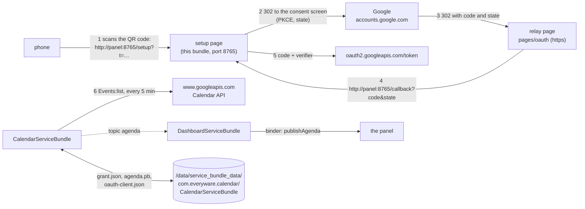

# The calendar bundle

`CalendarServiceBundle` (APEX `com.everyware.calendar`) is the agenda of the house. It links the
panel to a Google account the way Home Assistant does, reads the next seven days of the
account's primary calendar every five minutes and publishes them on the topic `agenda`
(`catalog/calendar.proto`, `catalog/everyware.vsidl`), together with the state of the link. The
screen gets it through the dashboard bundle (`IScreenLink.publishAgenda`) and shows the agenda,
or the QR code of the setup page while no account is linked.



## The link

Google's device flow (a code typed on a phone) does not allow the Calendar scopes, so the panel
uses the flow of a web application, with no server of its own:

1. While no account is linked, the bundle serves a small setup page on port 8765 of the panel
   and publishes its URL, `http://<panel's address>:8765/setup?t=<one-time token>`, in the
   agenda (`setup_url`). The screen shows it as a QR code.
2. The phone opens it. The page takes the token (once), begins a flow (a nonce and a PKCE
   verifier, kept in the bundle) and sends the phone to Google's consent screen with the
   challenge and the state: base64url of `{"p": "<panel's address>:8765", "n": "<nonce>"}`.
3. Google sends the phone to the client's redirect URI, the relay page, with the code and the
   state. Google takes only an https address there, and the panel has none.
4. The relay page reads the panel's address from the state and sends the phone on to
   `http://<panel>/callback?code=…&state=…`. It takes only what the panel writes there: a private
   IPv4 address with the port 8765.
5. The bundle checks the nonce (once, within ten minutes), exchanges the code with the verifier
   at Google's token endpoint, keeps the refresh token, closes the setup page and reads the
   calendar at once. The phone shows "Done. You can close this page."

The scope is `calendar.events.readonly`, the primary calendar only. The tokens never leave the
panel; the relay page sees the code, which is useless without the verifier.

## What goes where

| | |
|---|---|
| topic `agenda` (`Agenda`) | the link (`CALENDAR_NO_CLIENT`, `CALENDAR_NOT_CONNECTED`, `CALENDAR_CONNECTED`, `CALENDAR_EXPIRED`), the setup URL while there is no account, the calendar's title, up to 40 events in Google's order, the time of the last read |
| an event (`AgendaEvent`) | Google's id, title, place, start and end (unix seconds; an all-day event at 00:00 UTC, the end exclusive), all day or not, the event's own colour from Google's event palette (0: none, the screen's default) |
| a private or confidential event | the title "Busy", no place |
| a recurring event | each occurrence of the seven days is an event (`singleEvents=true`) |
| a cancelled event, an invitation the account declined | not in the agenda (`fields` asks for the account's own answer only: `attendees(self,responseStatus)`, `maxAttendees=1`) |
| the order | Google's (`orderBy=startTime`): by start in the calendar's time zone, an all-day event at the start of its day there. The bundle does not sort again: an all-day event's 00:00 UTC is 19:00 the day before in New York, so sorted by it Tuesday's holiday would come before Monday's dinner |
| `oauth-client.json` | the owner's OAuth client, Google's downloaded JSON; put there by `scripts/calendar-client.sh`; never in git or in the image |
| `grant.json` | the client's id and the refresh token, mode 0600 |
| `agenda.pb` | the last agenda, published again at the next start |

The colour of the calendar itself is not in the agenda: it needs the scope
`calendar.calendarlist.readonly`, which the panel does not ask for. An event without a colour
of its own has 0.

## The OAuth client

The owner of the panel makes the client in the Google Cloud console:

1. A project, the Google Calendar API turned on, the OAuth consent screen (External), and the
   owner's account as a test user, or the app published "In production". In "Testing" Google
   ends a refresh token after seven days, and the panel shows `CALENDAR_EXPIRED`. Published
   without Google's verification, the consent screen warns that the app is not verified.
2. An OAuth client of the type "Web application". Its first redirect URI is the one the panel
   uses: the relay page (`https://<where the page is hosted>/oauth/`), or
   `http://localhost:8765/callback` for development.
3. Download the JSON and put it on the panel:

```bash
ANDROID_SERIAL=<serial> vendor/sdv-everyware/everyware/scripts/calendar-client.sh client_secret_….json
```

The script needs adb as root. A bundle without a client finds the file within 10 s; one with
a client is restarted. A missing or broken file publishes `CALENDAR_NO_CLIENT` (the log says
why).

## Development without the relay page

Google allows `http://localhost` as the redirect of a web client, so the host's browser can do
the whole flow through adb:

```bash
adb forward tcp:8765 tcp:8765
adb logcat -s calendar_bundle:D | grep "setup URL"     # http://<panel>:8765/setup?t=<token>
```

Open the URL in the host's browser with `localhost:8765` in place of the panel's address. Google
sends the browser to `http://localhost:8765/callback`, which adb forwards to the panel.

## The relay page

`pages/oauth/index.html` is one static file: no external script, no request of its own, nothing
kept. It takes `code`, `state` or `error` from its query, decodes the state, and goes on only
when `p` is what the panel writes: a private IPv4 address (10/8, 172.16/12, 192.168/16), or
127.0.0.1 for development, with the port 8765 (no name, no other port):
`location.replace("http://<p>/callback?code=…&state=…")`.
It shows a "Continue" link too, because a browser may hold back a jump from an https page to an
address on the local network. Anything else shows the error. Its Content-Security-Policy allows
its own script only, by hash, and no referrer leaves it. Where it is hosted is not decided yet.

## How it is built

- `src/lib.rs`: the shape `vsidlc --services` generates (`ServiceBundle`, `SdvComms`, a
  current-thread runtime, `sdv_main` with the publisher). `handle_agenda_publisher` goes
  through the states: no client (look for the file every 10 s), no account (`run_setup`: the
  setup page), an account (`read_agenda`), and back to the setup page when Google says the
  grant is not good any more (`invalid_grant`: revoked or ended).
- `client/` (`libeveryware_calendar_client`, host test `everyware_calendar_client_test`): the
  OAuth client file, PKCE, the authorization URL, the state, the nonces and the setup token,
  the token endpoint's answers (`oauth.rs`); the setup page's requests and answers
  (`setup.rs`); Events:list as the agenda (`events.rs`); RFC 3339 times (`time.rs`); the panel's
  address (`net.rs`).
- `libs/https`: `post_form` for the token endpoint, `get_bearer` for the Calendar API.
- `libs/bundle-store`: the grant (`save_private`, 0600, written to a temporary file and
  renamed), the last agenda, the client file.
- `apex/`: manifest, orchestration (started at boot, instance-1), the authorization policy
  (`publisher` of `agenda`), test keys (public repository: not for a product).

## Timing

| When | What the bundle publishes |
|---|---|
| at its start | the last agenda with an account, when it is a day old at most; else the state of the link |
| every 10 s while there is no client | `CALENDAR_NO_CLIENT` until the file is there |
| while there is no account | the setup URL; a new one after every use, every ten minutes and when the panel's address changes (read every 10 s) |
| right after the link, then every 5 minutes | the agenda |
| a read that fails | the last agenda stays; tried again after 2 s, then twice as long each time up to 5 minutes (the network comes some seconds after the bundle at boot) |

The access token (an hour) is renewed two minutes before it ends, and when the API refuses it.

## The panel's address

The setup URL carries the panel's IPv4 address on the network: the local address on the subnet
of the interface with the default route, read from `/proc/net/route` and `/proc/net/fib_trie`.
The bundle's domain may read `/proc/net`; it has no UDP socket for the usual trick (a connected
UDP socket's local address). The address the phone reached the setup page on goes into the
state, so the relay page sends the phone back to the same one.

## Security

- The refresh token is the key to the account's events. It is in the bundle's directory only
  (SDV's `service_bundle_data`, the bundle's uid, mode 0600), never published, never in the log.
  The scope is read-only and events only.
- The setup page is plain HTTP on the local network and open only while no account is linked.
  Its token is random (32 bytes), good once and for ten minutes (a replaced one for one more
  minute), so only someone who sees the screen can begin a link. The flow's nonce is good once
  and for ten minutes; a code without the panel's PKCE verifier is worthless, so a code seen on
  the network or on the relay page cannot be used.
- The setup page answers GET on `/setup` and `/callback` only, reads at most 4 kB of a request
  in 10 s, serves 8 connections at a time, and its pages run nothing (`default-src 'none'`),
  are not cached and send no referrer. It closes a connection by dropping it: `shutdown()` is not
  among the socket permissions of the bundle's domain.
- The relay page goes only to a private IPv4 address or 127.0.0.1, on the port 8765, at the path
  `/callback`, with the code and the state. A crafted link can therefore make a browser call
  `GET /callback` on port 8765 of a host on its own network; it cannot send the browser anywhere
  else.
- The client secret is the owner's own client, put on the panel by adb. A secret of a web
  client is not a strong secret on a device anyway; PKCE and the state carry the proof.
- The calendar's title and the events are untrusted text: control characters taken out, cut to
  the catalog's bounds (the title 256 bytes, the place 128).
- A private or confidential event is "Busy" without its place: the panel is seen by everyone in
  the room. The calendar's title of a primary calendar is the account's address; the screen
  decides whether it shows it.
- SELinux: `untrusted_service_bundle`. Listening on port 8765 uses the TCP rules that HAR's
  policy gives the domain (`har_sdv_service_bundle_apex/lifecycle/sepolicy`); `/proc/net` is
  readable through the same file. No rule of its own.
- The setup URL is a debug line in the log (for the development flow). Whoever reads the log has
  adb, and with it the bundle's files.

## Testing

- `everyware_calendar_client_test` (host): the client JSON, PKCE with RFC 7636's vector, the
  authorization URL, the state there and back, nonces once and in time, the setup token, the
  token endpoint's answers (`invalid_grant`), Events:list as the agenda (timed, all day, private,
  cancelled, declined, recurring, missing fields, long text, Google's order kept), the setup page's requests, the address from
  `/proc/net`. `everyware_bundle_store_test`: the private file.
- The relay page: `node vendor/sdv-everyware/everyware/pages/test/oauth.test.js`.
- On the board: `adb logcat -s calendar_bundle` ("no OAuth client", "the setup page: open on
  192.168.1.23:8765", "the setup page: a link begins", "the account is linked", "12 events in
  the next 7 days"); the bridge: `-s dashboard_bundle` ("agenda: CALENDAR_CONNECTED, 12
  events").
