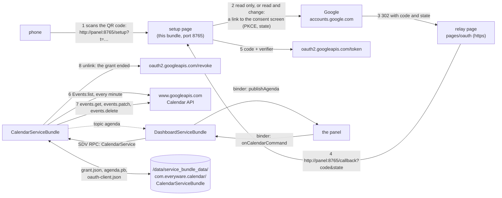

<!--
  Licensed under the Apache License, Version 2.0 (the "License");
  you may not use this file except in compliance with the License.
  You may obtain a copy of the License at

       http://www.apache.org/licenses/LICENSE-2.0

  Unless required by applicable law or agreed to in writing, software
  distributed under the License is distributed on an "AS IS" BASIS,
  WITHOUT WARRANTIES OR CONDITIONS OF ANY KIND, either express or implied.
  See the License for the specific language governing permissions and
  limitations under the License.
-->

# The calendar bundle

`CalendarServiceBundle` (APEX `com.everyware.calendar`) is the agenda of the house. It links the
panel to a Google account the way Home Assistant does, reads the next seven days of the
account's primary calendar every minute and publishes them on the topic `agenda`
(`catalog/calendar.proto`, `catalog/everyware.vsidl`), together with the state of the link. The
screen gets it through the dashboard bundle (`IScreenLink.publishAgenda`) and shows the agenda,
or the QR code of the setup page while no account is linked. The bundle also serves
`CalendarService` (`catalog/calendar_service.proto`): through it the screen unlinks the account,
and, when the owner gave the panel write access, answers invitations and deletes the account's
own events (without it those are answered `READ_ONLY`).



## The link

Google's device flow (a code typed on a phone) does not allow the Calendar scopes, so the panel
uses the flow of a web application, with no server of its own:

1. While no account is linked, the bundle serves a small setup page on port 8765 of the panel
   and publishes its URL, `http://<panel's address>:8765/setup?t=<one-time token>`, in the
   agenda (`setup_url`). The screen shows it as a QR code.
2. The phone opens it. The page takes the token (once), begins a flow (a nonce and a PKCE
   verifier, kept in the bundle) and asks what the panel may do with the calendar: **read only**
   (first, recommended) or **read and change**. Each answer is a link to Google's consent screen
   with the scopes of that access, the challenge and the state: base64url of
   `{"p": "<panel's address>:8765", "n": "<nonce>"}`. Both links belong to the same flow.
3. Google sends the phone to the client's redirect URI, the relay page, with the code and the
   state. Google takes only an https address there, and the panel has none.
4. The relay page reads the panel's address from the state and sends the phone on to
   `http://<panel>/callback?code=…&state=…`. It takes only what the panel writes there: a private
   IPv4 address with the port 8765.
5. The bundle checks the nonce (once, within ten minutes), exchanges the code with the verifier
   at Google's token endpoint, keeps the refresh token, closes the setup page and reads the
   calendar at once. The phone shows "Done. You can close this page."

The tokens never leave the panel. The relay page sees the code of the panel's own flow, which is
useless without the panel's verifier and the client secret.

## The access

| The owner chooses | The request asks for | The panel may |
|---|---|---|
| read only (the default) | `calendar.events.readonly` | show the events |
| read and change | `calendar.events.readonly` and `calendar.events` | also answer invitations and delete the account's own events |

Google grants the events of every calendar of the account; the code reads and changes the primary
calendar only. What decides is the scope Google **granted**, not the choice: the token answer's
`scope`, kept with the refresh token in `grant.json` and published as `Agenda.can_change`. The
consent screen lets the owner untick a scope; "read and change" asks for both so that unticking
the change still links the calendar, for reading. A refresh that names other scopes replaces the
kept ones, and a change Google refuses for a missing scope (403 `insufficientPermissions`) makes
the grant read only. A grant kept before the choice existed has no scope and counts as read only.
To change the access, the panel unlinks the account and links it again (next section): the setup
page asks for the choice once more.

## What goes where

| | |
|---|---|
| topic `agenda` (`Agenda`) | the link (`CALENDAR_NO_CLIENT`, `CALENDAR_NOT_CONNECTED`, `CALENDAR_CONNECTED`, `CALENDAR_EXPIRED`), the setup URL while there is no account, the calendar's title, up to 40 events in Google's order, the time of the last read |
| an event (`AgendaEvent`) | Google's id, title, place, start and end (unix seconds; an all-day event at 00:00 UTC, the end exclusive), all day or not, the event's own colour from Google's event palette (0: none, the screen's default), its description and its video meeting link (for the details a tap opens), the account's answer to its invitation, whether it is an occurrence of a recurring event, and what the screen may change of it (`can_respond`, `can_delete`) |
| the account's answer (`response`) | its own attendee's `responseStatus` when it is a guest and not the organizer (`organizer.self`); `RSVP_NONE` for its own events and for events it is not a guest of |
| `can_respond`, `can_delete` | with `Agenda.can_change` only: an answer when the account is a guest and not the organizer, a deletion when it is the organizer; never for a private or confidential event, for one that is not an ordinary event (`eventType` other than `default`: a birthday, an event from Gmail, out of office, focus time, a working location) or for an id that is not Google's whole id (longer than the catalog's 128 bytes) |
| the description | plain text, at most 2000 bytes: Google keeps one written in Calendar's editor as HTML, so the tags are taken out (a line break for `<br>`, a line of their own for paragraphs, `div`s and list items, "• " before an item), the entities decoded, control and direction characters taken out except the line break, no more than one blank line in a row, cut at a character with an ellipsis |
| the meeting link | the Google Meet link (`hangoutLink`), else the first video entry point of the conference data (Zoom, Teams); https only, at most 256 bytes, only the characters of RFC 3986 (no backslash, which a browser takes for a `/`) and no user part, so that it reads as the host it opens; else empty |
| a private or confidential event | the title "Busy", no place, no description, no meeting link |
| a recurring event | each occurrence of the seven days is an event (`singleEvents=true`) |
| a cancelled event, an invitation the account declined | not in the agenda (`fields` asks for the account's own answer only: `attendees(self,responseStatus)`, `maxAttendees=1`) |
| the order | Google's (`orderBy=startTime`): by start in the calendar's time zone, an all-day event at the start of its day there. The bundle does not sort again: an all-day event's 00:00 UTC is 19:00 the day before in New York, so sorted by it Tuesday's holiday would come before Monday's dinner |
| `oauth-client.json` | the owner's OAuth client, Google's downloaded JSON; put there by `scripts/calendar-client.sh`; never in git or in the image |
| `grant.json` | the client's id, the refresh token and the granted scopes, mode 0600 |
| `grants-replaced.json` | the grants of OAuth clients the owner replaced, until Google ended them, mode 0600 |
| `agenda.pb` | the link's state (connected, expired, not connected, no client) as an agenda without events, mode 0600: an expired link stays expired across a restart |
| `setup-url` | while the setup page is open: its URL with the one-time token, mode 0600, for the development flow; `scripts/calendar-setup-url.sh` prints it as a link for this computer |

The colour of the calendar itself is not in the agenda: it needs the scope
`calendar.calendarlist.readonly`, which the panel does not ask for. An event without a colour
of its own has 0.

## The OAuth client

The owner of the panel makes the client in the Google Cloud console:

1. A project, the Google Calendar API turned on, the OAuth consent screen (External), and the
   owner's account as a test user, or the app published "In production". In "Testing" Google
   ends a refresh token after seven days, and the panel shows `CALENDAR_EXPIRED`. Published
   without Google's verification, the consent screen warns that the app is not verified. The
   consent screen's "Data access" page lists the scopes the panel asks for:
   `https://www.googleapis.com/auth/calendar.events.readonly`, and
   `https://www.googleapis.com/auth/calendar.events` for "read and change".
2. An OAuth client of the type "Web application". Its first redirect URI is the one the panel
   uses: the relay page (`https://<where the page is hosted>/oauth/`), or
   `http://localhost:8765/callback` for development.
3. Download the JSON and put it on the panel:

```bash
ANDROID_SERIAL=<serial> vendor/sdv-everyware/everyware/scripts/calendar-client.sh client_secret_….json
```

Then delete the JSON from the computer: its secret is the only guard against a sign-in someone
else starts with the public client id (Security). The script needs adb as root. A bundle
without a client finds the file within 10 s; one with
a client is restarted. A missing or broken file publishes `CALENDAR_NO_CLIENT` (the log says
why), and so does a client Google refuses (next section).

## When Google says no

| Google's answer | The bundle's directory | The agenda |
|---|---|---|
| a read | `agenda.pb` says connected, without the events | `CALENDAR_CONNECTED` with the events and `updated` |
| `invalid_grant` (the access revoked or ended), the calendar scope gone | `grant.json` removed | `CALENDAR_EXPIRED` without events, the setup page again; still expired after a restart |
| `invalid_client`, `unauthorized_client`, `deleted_client` (the client deleted, its secret reset); the Calendar API turned off in the client's project (403 `accessNotConfigured`, `SERVICE_DISABLED`) | `grant.json` kept: a reset secret keeps the client's id, and the grant with it | `CALENDAR_NO_CLIENT` without events, not tried again until `oauth-client.json` changes (or the bundle restarts) |
| anything else (no network, a quota, Google busy) | | the last agenda stays, with `read_failed` once the reads have failed for half a minute (at a start the network comes a few seconds after the bundle); `updated` tells its age; tried again after 2 s, then twice as long each time up to 5 minutes |

A refused client is not tried every minute: the owner fixes it in the Cloud console and
runs `calendar-client.sh` again (a new secret is a new file; after turning the API on, the same
file again restarts the bundle). The events of before are dropped, so the screen does not show an
old week as current. While the reads only fail for a while, the screen can tell an old agenda
by `updated`; `updated` 0 with `CALENDAR_CONNECTED` means not read yet, not an empty week, and
with `read_failed` that the reads fail.

## Changes from the screen

With `Agenda.can_change` the event panel of the screen offers what an event allows: Accept, Maybe
and Decline on an invitation (`can_respond`, the current answer marked), Delete on the account's
own event (`can_delete`, after a confirmation on the screen; for a recurring event it deletes this
occurrence only). The screen sends a `CalendarCommand` through the dashboard bundle
(`ICommandSink.onCalendarCommand`), which calls `CalendarService.Respond` or `Delete` on this
bundle (SDV RPC, channel `calendar`) and hands the answer back
(`IScreenLink.publishCalendarResult`).

A change passes these checks, in this order (`client/src/change.rs`):

1. The caller is the dashboard bundle (its SDV identity, `com.everyware.dashboard`,
   `DashboardServiceBundle`): the authz policy lets any bundle that declares itself a client call.
2. The id is an event id as Google writes it (letters, digits, `_`, `-`, at most 128 bytes): only
   such an id goes into a URL. An answer is accepted, tentative or declined.
3. The agenda published last has the event and allows the change (`can_change`, then
   `can_respond` or `can_delete`).
4. Google's event as it is now (events.get) still allows it: not cancelled, the same rule as the
   agenda's.

Then the change, on that version of the event only (`If-Match` with its ETag; when it changed in
between, it is read again once):

| | the call | Google tells |
|---|---|---|
| an answer | events.patch of the occurrence with the attendees as events.get gave them, the account's own `responseStatus` changed (a patch replaces the whole list; with `attendeesOmitted` when Google left guests out, so only the account's answer changes); nothing when the answer is the one asked for already | the organizer (`sendUpdates=all`) |
| a deletion | events.delete of the occurrence | the guests (`sendUpdates=all`) |

When the change was made, or Google said something about the event or the access, the bundle
reads the calendar at once and publishes the new agenda, then answers (`CalendarResult`):

| Google's answer | `CalendarFailure` |
|---|---|
| done | none (`ok`) |
| 403 `insufficientPermissions` (the grant becomes read only, `can_change` false in the next agenda) | `READ_ONLY` |
| 404, 410, a cancelled event, an event no longer in the agenda | `GONE` |
| the event does not allow it any more, a malformed request | `NOT_ALLOWED` |
| another 4xx (a forbidden change, the API turned off) | `REFUSED` |
| no network, 429, 5xx, a quota, 412 twice, no answer within 40 s | `AGAIN` |
| no account, the grant revoked | `NOT_LINKED` |

A 401 renews the access token once. A change waits in a queue of four at most. The loop takes it
within 70 s (it may be in a read of the agenda), or it is not made at all and the answer is
`AGAIN` ("the calendar is busy; nothing was changed"): a change the screen was told failed is
never made later. From the moment the loop takes it the answer comes within 65 s: the change
within 40 s, the read of the agenda after it holds the answer back 20 s at most (a slower read is
not cancelled: the answer goes, the read goes on, and its agenda follows the answer). The dashboard bundle waits 150 s, the panel 160 s.
A change whose 40 s run out is answered `AGAIN` although Google may have made it; the next read
shows what Google has.

## Unlinking the account

`CalendarService.Disconnect`, with read or write access alike: the screen's "Disconnect" and
"Change access" (both after a confirmation on the screen). The same caller check as a change.

1. The bundle ends the grant at Google: its refresh token posted to
   `https://oauth2.googleapis.com/revoke` (the whole grant ends, every token of it). Google saying
   `invalid_token` (ended before) counts as ended.
2. Only then `grant.json` is removed and `agenda.pb` holds `CALENDAR_NOT_CONNECTED`, so a restart
   shows the setup page, not the old week. The agenda `CALENDAR_NOT_CONNECTED` goes out, then the
   answer (ok).
3. The setup page opens with a new one-time token and asks for the access again.

When Google cannot be told (no network, Google busy, no answer within 40 s) nothing changes: the
account stays linked and the answer is `AGAIN`. Without an account the answer is `NOT_LINKED`.

The panel also ends the grants it does not keep, so that none stays among the account's
third-party access with nobody holding it: on the setup page an exchange whose consent left out
the calendar, one without a refresh token, and the second of two sign-ins at the same time; and
the grants of an OAuth client the owner replaced (useless with the new client). Those are moved
out of `grant.json` into `grants-replaced.json` (0600, eight at most) before anything else, so a
new link cannot overwrite one before Google ended it; each is ended at Google, in a task of its
own so that the saved agenda, the setup page and the changes never wait for Google, at every pass of
the bundle's loop and at every start until Google was told, then forgotten.

## Development without the relay page

Google allows `http://localhost` as the redirect of a web client, so the host's browser can do
the whole flow through adb:

```bash
adb forward tcp:8765 tcp:8765
adb root
adb shell cat /data/service_bundle_data/com.everyware.calendar/CalendarServiceBundle/setup-url
# http://<panel>:8765/setup?t=<token>
```

The bundle writes the setup URL to `setup-url` in its directory (mode 0600, removed once the
setup ends), because it holds the one-time token and the bundle's debug lines do not reach
logcat. Reading it needs adb as root (a userdebug or eng build). Open the URL in the host's
browser with `localhost:8765` in place of the panel's address. Google
sends the browser to `http://localhost:8765/callback`, which adb forwards to the panel.

## The relay page

`pages/oauth/index.html` is one static file: no external script, no request of its own, nothing
kept. It takes `code`, `state` or `error` from its query, decodes the state, and goes on only
when `p` is what the panel writes: a private IPv4 address (10/8, 172.16/12, 192.168/16), or
127.0.0.1 for development, with the port 8765 (no name, no other port):
`location.replace("http://<p>/callback?code=…&state=…")`.
It shows a "Continue" link too, because a browser may hold back a jump from an https page to an
address on the local network. Anything else shows the error. Its Content-Security-Policy allows
its own script only, by hash, and no referrer leaves it. Where it is hosted is not decided yet.

## How it is built

- `src/lib.rs`: the shape `vsidlc --services` generates (`ServiceBundle`, `SdvComms`, a
  current-thread runtime, `sdv_main` with the publisher). It only loops, sleeps and publishes:
  `handle_agenda_publisher` goes through the states (no client, no account with `run_setup`, an
  account with `read_agenda`, and back as the table above says).
- `client/` (`libeveryware_calendar_client`, host test `everyware_calendar_client_test`), every
  decision with its test:
  - `link.rs`: one read (`Session`: the access token renewed before it ends and once more after a
    401, a new refresh token and the granted scope kept at once), one change
    (`Session::change`), and what each outcome leaves and publishes (`Link`).
  - `change.rs`: the screen's changes: the caller, the request, the agenda's rule and Google's
    event checked, the calls (events.get, events.patch, events.delete) and Google's refusals.
  - `server.rs`: the setup page's connections (the head bounded and read in time, the
    connections capped, the code exchanged, how the setup ends).
  - `google.rs`: Google as a trait; the bundle uses HTTPS, the tests a script.
  - `oauth.rs`: the client file, the access and the granted scope, PKCE, the authorization URL,
    the state, the nonces and the setup token, the token endpoint's answers. `setup.rs`: the
    setup page's requests and answers (the choice of access). `events.rs`: Events:list as the
    agenda, what an event allows, the API's errors. `time.rs`: RFC 3339. `net.rs`: the panel's
    address.
- `libs/https`: `post_form` for the token endpoint, `get_bearer` for the Calendar API's reads,
  `bearer` for its changes (a method, `If-Match`, a JSON body).
- `libs/bundle-store`: the grant (`save_private`, 0600, written to a temporary file and
  renamed), the link's state, the client file.
- `apex/`: manifest, orchestration (started at boot, instance-1), the authorization policy
  (`publisher` of `agenda`, `server` of `CalendarService`), test keys (public repository: not for
  a product).

## Timing

| When | What the bundle publishes |
|---|---|
| at its start | the state of the link; with an account: connected, not read yet (no events, `updated` 0). The events of an earlier run are not kept |
| every 10 s while there is no client | `CALENDAR_NO_CLIENT` until the file is there |
| while there is no account | the setup URL; a new one after every use, every ten minutes and when the panel's address changes (read every 10 s) |
| right after the link, then every minute | the agenda (a new event is on the screen within a minute) |
| a read that fails | the last agenda stays; tried again after 2 s, then twice as long each time up to 5 minutes (the network comes some seconds after the bundle at boot; an outage of Google, 429 or 5xx, is asked some 20 times an hour, not every minute) |
| Google refuses the client | `CALENDAR_NO_CLIENT` without events, until the client file changes |
| a change of the screen | made between two reads; the agenda read at once after it and published before the answer |
| an unlink from the screen | `CALENDAR_NOT_CONNECTED` once Google ended the grant, then the setup URL as at the first link |

The access token (an hour) is renewed two minutes before it ends, and when the API refuses it.

Every read is the whole window: seven days with the `fields` filter, a few kB, 1440 reads a day,
far below the Calendar API's quotas. Google's incremental sync (`syncToken`) does not fit: it
cannot be combined with `timeMin`, `timeMax` and `orderBy`, so it would sync the whole calendar
and the bundle would have to merge the changes into its own copy. `agenda.pb` is written when
the link's state changes, not at every read.

With the descriptions an agenda is at most about 112 kB (40 events with 2000 bytes of
description, 256 of meeting link and the rest of their bounds). The topic carries it as one
message (the news' thumbnails are 324 kB), and the dashboard bundle hands it to the panel in one
binder call, within binder's 1 MB buffer. Usually it is a few kB.

## The panel's address

The setup URL carries the panel's IPv4 address on the network: the local address on the subnet
of the interface with the default route, read from `/proc/net/route` and `/proc/net/fib_trie`.
The bundle's domain may read `/proc/net`; it has no UDP socket for the usual trick (a connected
UDP socket's local address). The address the phone reached the setup page on goes into the
state, so the relay page sends the phone back to the same one.

## Security

- The refresh token is the key to the account's events, of all its calendars (the scope is not
  narrower than that; the code reads and changes the primary one). It is in the bundle's
  directory only (SDV's `service_bundle_data`, the bundle's uid, mode 0600), never published,
  never in the log. Read only by default; with "read and change" whoever holds it can also change
  and delete every event of the account, not only what the panel offers.
- Write access is given to a shared screen: everyone at the panel can answer the owner's
  invitations and delete the owner's events, and Google sends the answer and the cancellation to
  the others in the owner's name. The owner chooses it on the setup page (read only first and
  recommended, the page says that anyone at the panel can change), and may untick it on Google's
  consent screen. A deletion needs a confirmation on the screen; nothing else stands between a
  tap and Google.
- The screen cannot reach Google directly or name any event: the calendar bundle takes a change
  only from the dashboard bundle (SDV identity, not only the authz policy), only for an id of the
  agenda it published itself, only with the access Google granted, and checks the rule again on
  Google's current event before it changes it on that version (`If-Match`). An id goes into a URL
  only when it is letters, digits, `_` and `-`. Private and confidential events, and events
  other than ordinary ones, are never changed from the screen.
- The setup page is plain HTTP on the local network, open only while a client is there and no
  account is linked. Its token is random (32 bytes), good once and for ten minutes (a replaced
  one for one more minute), so only someone who sees the screen can begin a link of the panel.
  The flow's nonce is good once and for ten minutes. PKCE makes the code of the panel's own flow
  worthless without the verifier the bundle keeps, so that code seen on the network or on the
  relay page cannot be used.
- What PKCE does not do: stop a flow someone else starts. The client id is public (it is in every
  redirect to Google), so an attacker can build his own authorization URL with his own challenge
  and a state that points at a host of his on the owner's network (port 8765), and get the owner
  to consent; the relay page then hands that host the owner's code. Only the client secret keeps
  him from exchanging it. The secret therefore belongs on the panel only (0600):
  `calendar-client.sh` asks the owner to delete the downloaded JSON after the push.
- What it does not do either: a person who reads the Wi-Fi traffic while the owner opens the
  setup page sees the challenge and the state in the redirect, can finish that flow with his own
  account first, and the panel then links his calendar (no access to the owner's data, but his
  agenda on the screen). The undo is the panel's "Disconnect" (CalendarService.Disconnect, its
  grant ended at Google); there is no confirm of the linked account before it shows.
- Anyone at the panel can unlink the account (after the confirmation on the screen): the agenda
  is gone until the owner links again, and the setup page that opens lets whoever sees the
  screen link an account (as at the first link).
- The setup page answers GET on `/setup` and `/callback` only, reads at most 4 kB of a request
  in 10 s, serves 8 connections at a time, and its pages run nothing (`default-src 'none'`),
  are not cached and send no referrer. It closes a connection by dropping it: `shutdown()` is not
  among the socket permissions of the bundle's domain.
- The relay page goes only to a private IPv4 address or 127.0.0.1, on the port 8765, at the path
  `/callback`, with the code and the state. A crafted link can therefore make a browser call
  `GET /callback` on port 8765 of a host on its own network; it cannot send the browser anywhere
  else.
- The client secret is the owner's own client, put on the panel by adb, never in git or in the
  image.
- The calendar's title and the events are untrusted text: control characters taken out, cut to
  the catalog's bounds (the title 256 bytes, the place 128).
- A description is untrusted text from whoever wrote the event or sent the invitation (a stranger's
  invitation too, unless the owner declined it), and it may hold what a meeting needs: a dial-in
  PIN, a document link. It goes to the shared screen as plain text only (HTML made text in the
  bundle, in linear time: a crafted description costs its length), and the screen shows it only
  when someone taps the event. The meeting link is https only; a private or confidential event
  has neither. The meeting link is the organizer's choice (a third-party conference may carry
  any https address): the panel shows it as text, and as a QR code only after a tap on Join on
  phone, with the host the phone will open under the code ("Opens meet.google.com"), and only for
  a host of plain ASCII letters, digits, dots and dashes.
- A private or confidential event is "Busy" without its place: the panel is seen by everyone in
  the room. The calendar's title of a primary calendar is the account's address; the screen
  decides whether it shows it.
- SELinux: `untrusted_service_bundle`. Listening on port 8765 uses the TCP rules that HAR's
  policy gives the domain (`har_sdv_service_bundle_apex/lifecycle/sepolicy`); `/proc/net` is
  readable through the same file. No rule of its own.
- The setup URL is not in the log. For the development flow it is in `setup-url` in the
  bundle's directory (0600, the bundle's uid, gone once the setup ends): only root reads it, and
  root has the bundle's files anyway.

## Testing

- `everyware_calendar_client_test` (host):
  - the changes: the caller (only the dashboard bundle), the request (ids that are not Google's,
    no answer given), the agenda's rule (read only, gone, not allowed, no account), Google's
    event (cancelled, made private, not the organizer, not a guest, not an ordinary event), the
    patch body (the whole list back, only the account's answer changed, `attendeesOmitted`
    carried, nothing when the answer is the one asked for), the URLs (`sendUpdates=all`,
    `If-Match`), Google's refusals mapped, a 401 renewing the token once, a 412 reading again
    once, the network, a revoked grant, a read-only answer making the grant read only (0600);
  - the unlink: the grant ended at Google before it is forgotten, not connected after a restart,
    the account kept when Google cannot be told; the grants the panel does not keep ended (a
    consent without the calendar, no refresh token, a second sign-in); a replaced client's grant
    set aside so that a new link cannot overwrite it, kept until it is ended (at most eight);
    the revocation endpoint's answers (`invalid_token` counts as ended);
  - the access: the scopes asked for per choice, the scope Google granted (read, change, neither),
    the granted scope kept with the grant and taken from a refresh, an old grant read only, no
    event offering a change without it, what an event allows (organizer, guest, recurring,
    private, Gmail and out-of-office events, ids);
  - the link: a 401 gives one refresh and one more read, the access token renewed before it
    ends, a new refresh token kept at once (0600), `invalid_grant` and a lost scope end in
    `CALENDAR_EXPIRED` (also after a restart), a refused client and the Calendar API turned off
    end in `CALENDAR_NO_CLIENT` without events until the client file changes, the network tried
    again, only the link's state kept for the next start, a grant of another client not taken,
    a read a minute and the backoff after failures (an hour of outage is at most 20 requests), an
    unchanged agenda not written every minute, the setup URL file (0600, removed);
  - the setup page's connections: from the QR code to the grant (the choice of access with its
    two links of one flow, the address the phone reached in the state, the exchange with the
    verifier of the challenge, the granted scope in the grant), a token used once, a refused
    client ends the setup, the head bounded to 4 kB, a slow request closed without an answer, a
    connection over the limit closed at once (on loopback sockets);
  - the client JSON, PKCE with RFC 7636's vector, the authorization URL, the state there and
    back, nonces once and in time, the setup token, the token endpoint's answers and the API's
    errors, Events:list as the agenda (timed, all day, private, cancelled, declined, recurring,
    missing fields, long text, Google's order kept), the setup page's requests, the address from
    `/proc/net`. `everyware_bundle_store_test`: the private file.
- The relay page: `node vendor/sdv-everyware/everyware/pages/test/oauth.test.js`.
- On the board (not run there yet; these are the lines the code writes, with example values):
  `adb logcat -s calendar_bundle` should show "no OAuth client", "the setup page: open on
  192.168.1.23:8765", "the setup page: a link begins", "the account is linked", "12 events in
  the next 7 days"; the bridge, `-s dashboard_bundle`, "agenda: CALENDAR_CONNECTED, 12 events".
  A change: "Delete { event_id: \"…\" }: made" in the bundle, "calendar delete \"…\": ok true" in
  the bridge.
