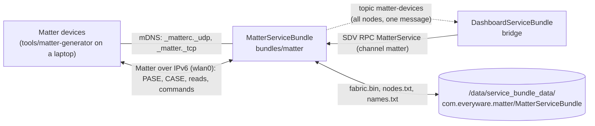

# The Matter bundle

`MatterServiceBundle` (APEX `com.everyware.matter`) owns the house's Matter fabric. It
commissions the devices whose pairing codes it is given, reads what their clusters report and
publishes all of them as one message on the topic `matter-devices`
(`catalog/matter.proto`); it offers the RPC `MatterService` (`catalog/matter_service.proto`) for
pairing and for the devices' commands. The screen gets the devices through the dashboard bundle
and never speaks Matter.



## What goes where

| | Topic `matter-devices` (`MatterDevices`) | RPC `MatterService` |
|---|---|---|
| what | per node: online, last seen, Basic Information (vendor, product, serial, software version, VID, PID), uptime, boot reason; per endpoint the device type, the name the house gave it and the clusters it serves: Thermostat, Relative Humidity, On/Off, Level Control, Fan Control | `Pair(code)`, `SetOnOff`, `MoveToLevel`, `SetSetpoint`, `SetSystemMode`, `SetFanMode`, `Rename`; each answers `MatterResult` (ok, why not, node id) |
| when | after a poll that changed something: a poll starts 2 s after the last one and takes 2 to 4 s for the four virtual devices (one transaction per attribute) | when the device acknowledged the command (a pairing: up to two minutes) |
| why so | one message: a subscriber that comes late gets the last message of a topic (`read_on_subscribe`), so it gets every device | a command has an outcome; the new state comes with the next poll, started at once |

## The devices' names

A device of the house is an endpoint of a node, and the house names it: `Rename(node, endpoint,
name)` keeps the name in `names.txt` in the bundle's directory (`src/names.rs`; a line per device:
the node id in hex, the endpoint, the name), and every `MatterDevices` carries it in
`MatterEndpoint.name`. The device itself is not told: Matter's own label (Basic Information's
NodeLabel) is one per node, and a node with four endpoints is four devices here. Other Matter
controllers keep their names the same way, in their own data.

A name is at most 32 bytes of UTF-8 (the length of a NodeLabel), without control characters, runs
of spaces as one; an empty name takes the name away, and the screens show their own word again.
`Rename` answers "no such device" for an endpoint the last poll did not read. The devices go out
again at once with the new name, without waiting for the next poll.

## How it is built

- `Android.bp`: the bundle links every Rust dependency as an rlib (`prefer_rlib`) with
  `-Wl,--no-as-needed`, as SDV's sample bundle does (`samples/health`): the controller and
  rs-matter are rlibs, and a crate linked as a dylib too would be a second copy of it.
- `src/lib.rs`: the shape `vsidlc --services` generates (`ServiceBundle`, `SdvComms`, a
  current-thread runtime, `sdv_main` with the publisher and the RPC server). It turns the
  controller's snapshots into the catalog's message and the RPC calls into the controller's
  commands.
- `client/` (`libeveryware_matter_client`, host test `everyware_matter_client_test`): the
  controller on rs-matter (`vendor/sdv-everyware/third_party/rust`, crypto on BoringSSL). It runs
  on a thread of its own: rs-matter's futures run on async-io, not on the bundle's tokio.
  - `fabric.rs`: the fabric. The controller is its own certificate authority: a root certificate,
    an intermediate one that signs the nodes' certificates, its own certificate and key, the IPK.
    Created once, kept in `fabric.bin`, installed in rs-matter again at every start, so the nodes
    commissioned before are reached without commissioning them again. The root's key is not kept.
    The nodes and the code each was paired by are in `nodes.txt`.
  - `net.rs`: the interface (`wlan0`, once it has an IPv6 link-local address; its IPv6
    addresses from `/proc/net/if_inet6`, the IPv4 one from getifaddrs), Matter's socket
    (an ephemeral port: the controller only initiates) and the mDNS socket (5353, both multicast
    groups) for rs-matter's built-in responder, which browses and resolves the devices.
  - `node.rs`: one node: its endpoints (the root's PartsList, each endpoint's device types and
    server clusters) and what does not change are read once; a poll reads the rest. One CASE
    session per node, one exchange per attribute (rs-matter's generated cluster clients).
  - `lib.rs`: the controller's loop: commands first, then the codes not paired yet (every
    30 s), then the poll.
- `apex/`: manifest, orchestration (started at boot, instance-1), the authorization policy
  (`publisher` of `matter-devices`, `server` of `MatterService`), `pairing.txt` (the codes to
  commission, one per line), test keys (public repository: not for a product).

## Commissioning

```
pairing.txt: 3497-011-2332 ──► passcode + short discriminator (rs-matter's manual code parser)
  1. mDNS browse _matterc._udp for that discriminator ──► the device's instance and addresses
  2. PASE with the passcode; ArmFailSafe, CSR, AddTrustedRootCertificate, AddNOC (node id 0x10, 0x11 ...)
  3. mDNS resolve of the node on the fabric (_matter._tcp) ──► CASE ──► CommissioningComplete
  4. the node and its code go into nodes.txt: commissioned once
```

The devices are test devices (test attestation): rs-matter does not verify attestation against
the DCL yet, so the bundle accepts test attestation. The other Matter devices of the network
(other fabrics) are never touched: the bundle commissions only by its codes.

## Timing

The bundle starts before the Wi-Fi is up. The controller waits for `wlan0` to have an IPv6
link-local address (net_bringup.sh enables IPv6 on `wlan0`; SDV core switches it off on every
interface), then runs. A node that misses three polls is offline in the message and keeps its
last values; its endpoints are read again when it answers.

## Security

- Matter's own: PASE (the passcode) to commission, CASE (the fabric's certificates) after;
  everything encrypted and authenticated by Matter.
- The fabric's keys are in the bundle's directory (SDV's, owned by the bundle's uid).
- Only this bundle publishes `matter-devices` and serves `MatterService` (its policy).
- The bundle runs in a domain of its own, `matter_service_bundle`
  (`device/rb3/sdv_media_db845c/sepolicy/system_ext`, mapped in `product/service_bundle_contexts`):
  a service bundle domain plus AOSP's `net_domain`, UDP sockets bound to Matter's port and to
  mDNS's 5353 with the multicast groups joined, and the interface queries (netlink route, the
  interface ioctls). The default domain of the bundles (`untrusted_service_bundle`) has none of
  it: the other bundles reach the network only through SDV's agents.

## Testing

- `everyware_matter_client_test` (host): temperatures, bitmaps, the node list.
- On the board: `adb logcat -s matter_bundle`: the interface, the fabric, the pairing steps,
  every node's endpoints and clusters, and a line per change of its values:

```
paired 3497-011-2332 as node 0x10
node 0x10: ep1 type 0x0301 clusters [0x001d 0x0003 0x0201 0x0405], ep2 type 0x0100 ..., ep3 type 0x0101 ..., ep4 type 0x002b ...
node 0x10: EveryWare Virtual Home sn EW-VH-0001 sw 0.1.0 up 70 s; ep1 thermostat Some(21.8) °C heat 22 cool 26 Heat idle humidity Some(45.34) %; ep2 on true ...; ep3 on true ... level Some(166) [1..254]; ep4 fan Low Some(33)/33 % (OffLowMedHigh)
```
- The devices: `tools/matter-generator` on a Linux machine with IPv6 on the same network.
