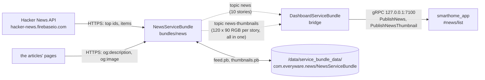

# The news bundle

`NewsServiceBundle` (APEX `com.everyware.news`) is the one place of the house that reads the
news: every ten minutes it takes the top ten stories of Hacker News, reads each new story's
article once for its description and its picture, and publishes the feed on the topic `news`
and the thumbnails of its stories on `news-thumbnails` (`catalog/news.proto`,
`catalog/everyware.vsidl`). The screen gets both through the dashboard bundle and shows them as
the news feed in the right column; it has no network of its own.

## What goes where

| | Topic `news` (`NewsFeed`) | Topic `news-thumbnails` (`NewsThumbnails`) |
|---|---|---|
| what | up to 10 stories: id, title, site, link, summary, points, comments, author, time | the pictures of the feed's stories: per story its id and RGB 120 x 90 (3 bytes a pixel, 32 400 bytes), up to 10 |
| when | every ten minutes: once when the stories are known, again with the summaries of the new ones | after every feed with its summaries |
| why a topic of its own | the feed is there before the pictures | a picture is 30 times a story; with the feed they would hold it back |
| why one message | | a subscriber that comes late gets the last message of a topic (`read_on_subscribe`), so it gets every picture |
| on the screen | a list item (kind image, lines three): the headline, the summary (else "site · points · comments"), the age | the picture of the row, registered under `news/<id>` (everyware_ui::images) |

The thumbnail is the size the screen shows, as raw pixels: the bundle decodes and scales the
picture, the screen has nothing to decode and no picture library to run on untrusted data.

## How it is built

- `src/lib.rs`: the shape `vsidlc --services` generates (`ServiceBundle`, `SdvComms`, a
  current-thread runtime, `sdv_main` with the two publishers). `handle_news_publisher`
  publishes the last feed first, then reads the feed every ten minutes; a story's article and
  picture are read once and kept by id while the story is in the feed.
- `libs/bundle-store` (`libeveryware_bundle_store`): the last feed and its thumbnails in the
  bundle's directory, for the next start.
- `client/` (`libeveryware_news_client`, host test `everyware_news_client_test`): the Hacker
  News API (`topstories.json`, `item/<id>.json`), the meta tags of a page (`og:description`,
  else `description`; `og:image`, else `twitter:image`; entities decoded, the summary cut at a
  word to 300 bytes), the thumbnail (JPEG or PNG decoded by `image` with `zune-jpeg`, the
  middle 4:3 cropped, scaled to 120 x 90).
- `libs/https` (`libeveryware_https`): HTTPS on SDV's TLS stack (hyper, tokio-openssl,
  BoringSSL) with the system's CA store, redirects followed, the body limited (1.5 MB a page,
  4 MB a picture) and a request in time (15 s). The weather's Open-Meteo client uses it too.
- `apex/`: manifest, orchestration (started at boot, instance-1), the authorization policy
  (`publisher` of both topics), test keys (public repository: not for a product).

## Timing

The bundle starts at about 6 s after the boot, the network is there at about 18 s (Wi-Fi,
then DHCP). So:

| When (RB3, s since boot) | What the bundle publishes |
|---|---|
| at its start (about 6) | the last feed and its thumbnails, kept from the previous start (`feed.pb`, `thumbnails.pb`), not older than 24 hours |
| tries every second until it works (about 19) | the new feed, as soon as the stories are known (titles; the summaries known from before) |
| about 1 to 3 s later | the feed with the summaries of the new stories, and the thumbnails |
| every ten minutes | the same two steps |

A first attempt fails while there is no lease ("No address associated with hostname"). A new
feed reads only the articles of new stories, in parallel; a page or a picture that does not
answer in time (15 s) leaves that story without a summary or a picture, the feed goes out
anyway.

The files are in SDV's directory of the bundle, `/data/service_bundle_data/com.everyware.news/
NewsServiceBundle` (the lifecycle manager creates it with the bundle's uid; SELinux type
`service_bundle_data`). A file is replaced at once (written to a temporary one, renamed).

## Security

- The bundle reaches the internet (`untrusted_service_bundle` has tcp sockets); nothing else
  on the panel does for the news.
- TLS with the system's CA store, https only (a link or a picture over plain http is not
  read).
- The pages and the pictures are untrusted data: the HTML is scanned for its meta tags only,
  in the bundle; a picture is decoded by memory-safe Rust (`image`, `zune-jpeg`), in the
  bundle; what leaves the bundle is text of bounded size and pixels of a fixed size.
- Only this bundle publishes `news` and `news-thumbnails` (its policy).

## Pictures

JPEG and PNG pictures become thumbnails. A story whose page has no picture, or a WebP one,
keeps the placeholder of the design in its row.

## Testing

- `everyware_news_client_test` and `everyware_https_test` (host): parsing, meta tags, the
  thumbnail, URLs and redirects.
- On the board: `adb logcat -s news_bundle` ("the last feed: 10 stories, 5 with a picture",
  "10 stories, 1 new, their articles next", "10 stories, 8 with a summary, 5 with a
  picture"); the bridge: `-s dashboard_bundle` ("10 news stories").
