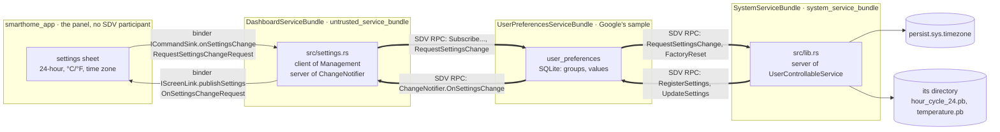
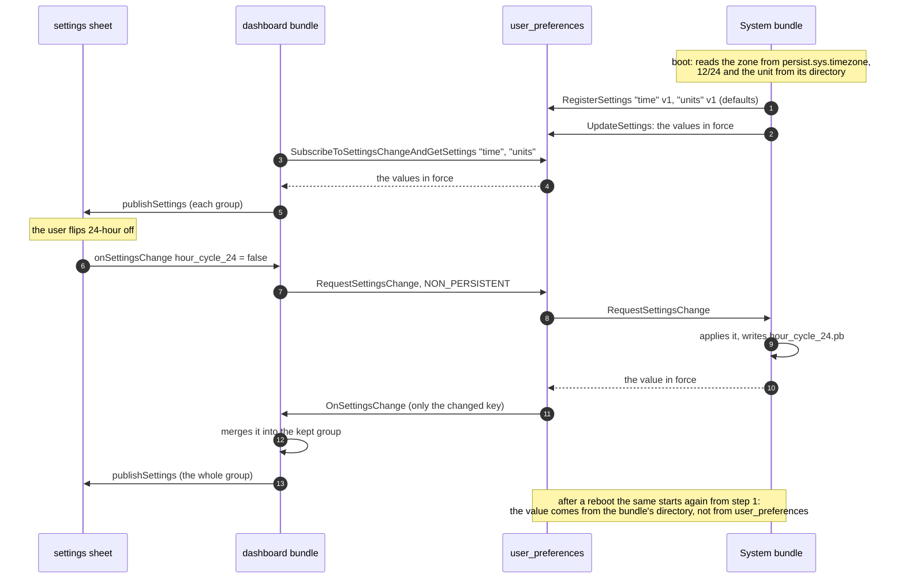

# The System bundle

`SystemServiceBundle` (APEX `com.everyware.system`) owns the system settings of the device:
the time zone, whether the clock shows 24 hours and the unit of temperatures. The values live in SDV's
`user_preferences` service. The bundle registers them there as a user-controllable group,
applies a change and reports the value in force.

## Who talks to whom

The messages are Google's
(`system/software_defined_vehicle/automotive_services/user_preferences/vsidl/v1/*.proto`); the
groups and keys are in `src/lib.rs`. The panel and the bridge are in
`bundles/dashboard/README.md`.

## At boot, a change, a reboot

Why the bundle keeps the values itself: the settings are SHARED, and `user_preferences` does
not push a SHARED value to its owner at start. It keeps what the owner reports. So the owner
is where a value survives a reboot: the time zone in its property, the rest in its directory.

| Key | Type | Default | Applied by |
|---|---|---|---|
| `time/timezone` | text (UTF-8) | `Etc/UTC` | the system property `persist.sys.timezone` |
| `time/hour_cycle_24` | bool | true | the screen reads it, the bundle keeps it |
| `units/temperature` | enum: 0 Celsius, 1 Fahrenheit | 0 | the screen reads it, the bundle keeps it |

- A zone name is checked against the device's tzdata. An unknown name is refused, and the
  value in force is reported back.
- `FactoryReset` applies the defaults and reports them.
- The bundle waits until `user_preferences` is there, then retries the registration every
  5 seconds until it is accepted.

## SELinux

Setting `persist.sys.timezone` needs `set_prop(timezone_prop)`, which the default bundle
domain has not. `product/service_bundle_contexts` maps the bundle to its own domain
`system_service_bundle` (device/rb3/sdv_media_db845c/sepolicy). The domain adds two rules to
a service bundle: this one, and reading the CPU quota of its cgroup, which tokio does at start.
