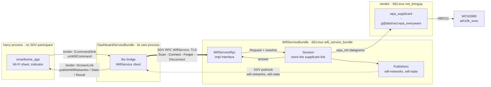
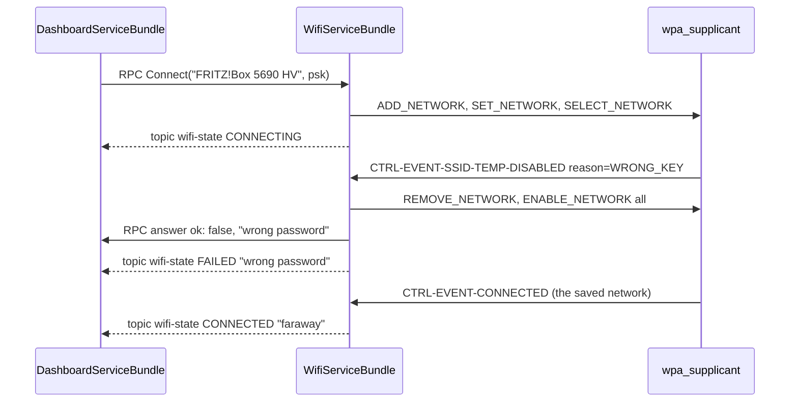

# The Wi-Fi bundle

`WifiServiceBundle` (APEX `com.everyware.wifi`) owns the Wi-Fi of the device: it scans,
publishes the networks around and the state of the connection, and serves the SDV RPC
`WifiService`: scan, join, forget or leave a network, each call answered. The screen never
touches the Wi-Fi stack.



| Line | What | Who may use it |
|---|---|---|
| thick | SDV RPC: a command and its answer (`catalog/wifi_service.proto`) | the authz policies: `server` here, `client` in the bridge |
| dotted | SDV pub/sub: what the bundle sees, for any subscriber (`catalog/wifi.proto`) | `publisher` here, `subscriber` in the bridge |
| thin | local links: binder to the screen, the supplicant's control socket, the driver | SELinux (the abstract socket has no file permission) |

Topics and messages: `catalog/wifi.proto`; the service: `catalog/wifi_service.proto`; who
offers and who calls: `catalog/everyware.vsidl` (`server { service: "WifiService" channel:
"wifi" }` here, `client { ... }` in the dashboard bundle). What many read (the networks
around, the state of the connection) is a topic; what the screen asks for is a call with an
answer. A connect is answered when it is over: joined, or why not ("wrong password",
"network not found"), within 35 s (the supplicant tries a wrong key three times before it
gives up). A call that does not get through (no server, the deadline) fails for its caller,
so the screen never waits for a command that was lost.

| | RPC `WifiService` (what the screen asks for) | topics `wifi-networks`, `wifi-state` (what the bundle sees) |
|---|---|---|
| what | `Scan`, `Connect`, `Forget`, `Disconnect` | the networks around; the state of the connection |
| answer | each call has one, for its caller (`WifiResult`: ok, or why not) | none: every subscriber gets every update |
| a lost message | the call fails (no server, the 40 s deadline), the screen says so | the next update replaces it |
| who | the policy's `client` entry: the dashboard bundle | the policy's `subscriber` entries: the dashboard bundle |
| code | the `Interface` trait (vsidlc), a channel to the session, a oneshot per call | a publisher per topic, deduplicated |

The split is by the kind of exchange, not by the direction. The RPC goes both ways on the same
call: the request from the bridge to the bundle, the answer back to the caller. The topics go
one way only, from the bundle to every subscriber. So:

- bridge → bundle: only RPC requests (`Scan`, `Connect`, `Forget`, `Disconnect`);
- bundle → bridge: the answers to those calls, and the two topics.

An answer reaches only the caller, and only about its own call. Much changes without anybody
asking: the access point goes away or the signal drops, the board joins a saved network by
itself after a boot, the scan every minute finds new networks, a second screen or a logger
wants the same view without asking anything. That is the state of the Wi-Fi, so it is a
topic. A connect with a wrong password, as on the board:



The last step has no call behind it: the board goes back to its network on its own, and only
the topic tells.

## Why a bundle, and why the control interface

The supplicant is a system service; nothing of it belongs in the UI process (a crash there
would take the screen down, and the screen would own a password). A bundle is the SDV unit
for exactly this: its own process, its own SELinux domain, its own authorization policy for
the two topics it publishes and the RPC service it serves.

Three ways to reach the supplicant were weighed:

| | hostap control interface (chosen) | AIDL `ISupplicant` HAL | a helper daemon |
|---|---|---|---|
| what | the `wpa_ctrl` datagram protocol the `wpa_cli` tool uses (`SCAN`, `SCAN_RESULTS`, `ADD_NETWORK`, `SET_NETWORK`, `SELECT_NETWORK`, `STATUS`, events) | binder, the API Android's Wi-Fi service uses | a small native process the bundle talks to |
| scan | yes | no: Android scans through `wificond` and nl80211, the HAL has no scan | yes |
| code | ~150 lines of Rust in the bundle, no new dependency | binder client, large API | one more process, one more IPC |
| trust | the bundle's domain reaches the supplicant's socket, nothing else | binder permissions | the daemon's domain |

The control interface is served on an **abstract unix socket** (`-g@abstract:wpa_everyware`,
`device/rb3/sdv_media_db845c/net/net_bringup.sh`): there is no file, so there is no file
permission (DAC) to get through, and no group `wifi` for the bundle to be in. SELinux alone
says who may talk to it. The per-interface socket directory the supplicant also keeps
(`/data/vendor/wifi/wpa/sockets`, `wifi:wifi` 770) stays for `wpa_cli` and the bring-up
script's watchdog.

## How it is built

The bundle speaks SDV both ways: **pub/sub** for what it sees, **RPC** for what it is asked
to do. One task, the `Session`, owns the connection to the supplicant; the RPC server hands
it every call and waits for its answer.

```
DashboardServiceBundle                    WifiServiceBundle (src/lib.rs)
  Client::Connect(req) ──SDV RPC, TLS──► WifiServiceRpc (impl Interface)
                                            │ mpsc: Request::Connect(req, oneshot)
                                            ▼
                                          Session ──wpa_ctrl──► wpa_supplicant
                                            │  events: CONNECTED [id=N] / TEMP-DISABLED WRONG_KEY
  ◄──────────── WifiResult ◄── oneshot ◄────┤
  ◄── topic wifi-networks ◄── Publisher ◄───┤  every new scan, deduplicated
  ◄── topic wifi-state ◄───── Publisher ◄───┘  every change of the connection, deduplicated
```

- `catalog/everyware.vsidl`: `publisher` `wifi-networks` and `wifi-state`, `server {
  service: "WifiService" channel: "wifi" }`. vsidlc generates the bundle crate (its
  builder has `set_server_wifi`) and the RPC crate `libcom_everyware_wifi_service_rpc_rs`
  (the `Interface` trait, the `Client`; `catalog/generated/Android.bp`).
- `src/lib.rs`: the shape `vsidlc --services` generates (`ServiceBundle`, `SdvComms`, a
  current-thread runtime, `sdv_main`). `sdv_main` builds the bundle with
  `set_server_wifi(WifiServiceRpc)` and creates the two publishers; `WifiServiceRpc` turns
  each call into a `Request` with a oneshot for the answer (deadline 35 s for a connect,
  15 s for the rest); `Session` runs the supplicant's requests and events, answers the
  calls and publishes the topics.
- `src/wpa_ctrl.rs`: the control protocol (requests, events, the parsers).
- `apex/permissions.textproto`: `publisher` of the two topics, `server` of
  `com.everyware.WifiService` on the channel `wifi`.

## The list of networks

The bundle scans every 60 s and when the screen asks (the sheet opens, Rescan). The list is
what the last scan saw: the bundle sets the supplicant's cache to drop a network missing from
one scan (`BSS_EXPIRE_COUNT 1`, the supplicant's default keeps it for two scans and 180 s),
with an age just above the scan interval (`BSS_EXPIRE_AGE 70`) so the cache's own timer does
not drop networks between scans. A hotspot switched off leaves the list at the next scan,
within 60 s, or at once with Rescan.

## Security

- **Its own SELinux domain.** The SDV lifecycle manager starts every bundle as
  `untrusted_service_bundle` unless `/product/etc/service_bundle_contexts` names another
  domain for it (`system/software_defined_vehicle/lifecycle_management`,
  `selinux_policy_reader.rs`). The product ships that file with
  `com.everyware.WifiServiceBundle wifi_service_bundle`, and
  `device/rb3/sdv_media_db845c/sepolicy` defines `wifi_service_bundle`: a service bundle domain
  plus the one thing other bundles must not have, sending datagrams to the supplicant's
  socket. The weather and the dashboard bundles cannot reach the supplicant.
- **Core to vendor socket.** The supplicant runs in a vendor domain (`net_bringup`, the
  bring-up script's), the bundle in a core one; Treble forbids sockets between the two in
  general. This image has no Android framework, owns both sides in `device/rb3`, and marks
  the bundle `socket_between_core_and_vendor_violators` on purpose; the rule is the single
  `allow wifi_service_bundle net_bringup:unix_dgram_socket sendto`.
- **Who may command.** Only `WifiServiceBundle` serves `com.everyware.WifiService` and only
  `DashboardServiceBundle` is its client (their authorization policies). A bundle without the
  `client` entry cannot call it. The calls between the two bundles go over SDV's RPC transport
  with TLS (certificates from the lifecycle manager).
- **The password.** It travels screen → binder (`ICommandSink`) → bridge → `WifiService.Connect`
  (TLS) → bundle → supplicant, inside one machine, over channels that SELinux and the SDV
  authorization policy gate; the screen takes calls only from the bridge. No log line carries it. It is stored by the supplicant only (`SAVE_CONFIG` into
  `/data/vendor/wifi/wpa_supplicant.conf`, `wifi:wifi`), never by the bundle or the screen,
  and the state topic carries no password. A password typed on the screen is cleared from the
  sheet when it closes.
- **What the screen cannot do.** It cannot scan, join or forget on its own: every one of
  these is a call the bridge makes and this bundle executes; the screen only sees the
  results. A compromised UI process gets the networks around and the state, nothing more.
- **Enterprise networks** (802.1x) are refused: a certificate and an identity are not a
  password, and the screen has no way to provision them yet.

## State of the board today

SELinux on the RB3 image runs permissive (`getenforce`), so the policy above is not yet
enforced; it is written so the image can switch to enforcing without a change here. The
bring-up script starts the supplicant with the global interface; until the vendor image is
rebuilt, the board's supplicant is started by hand with the same flag for a test.

## Testing

- `wpa_cli -g@abstract:wpa_everyware` as root talks to the same interface the bundle uses.
- The bundle's log: `adb logcat -s wifi_bundle`; the bridge: `-s dashboard_bundle`.
- A connect with a wrong password is answered `ok: false, "wrong password"` (the bridge logs
  `Wi-Fi connect "<ssid>": ok false "wrong password"`) and ends in `wifi-state`
  `WIFI_FAILED` (`CTRL-EVENT-SSID-TEMP-DISABLED reason=WRONG_KEY`); a network that is not
  there in `"network not found"`. The board returns to the network it was on.
- At start the bundle logs `serving WifiService on the channel wifi`, the bridge
  `calling WifiService#wifi` once the server is registered.
