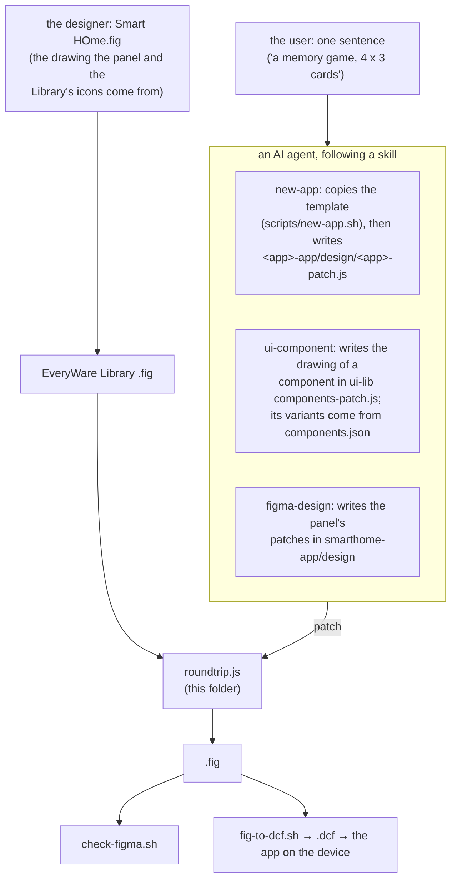
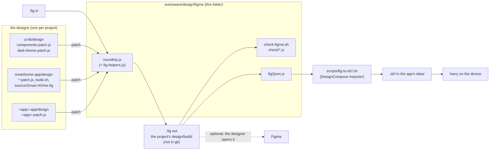
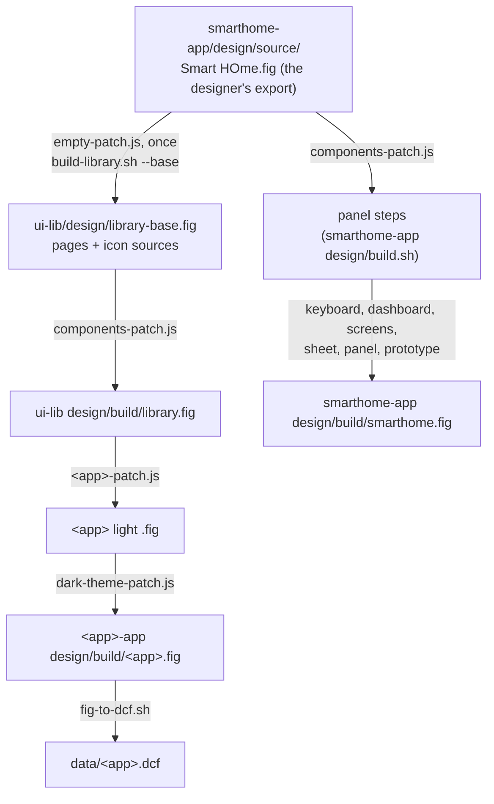
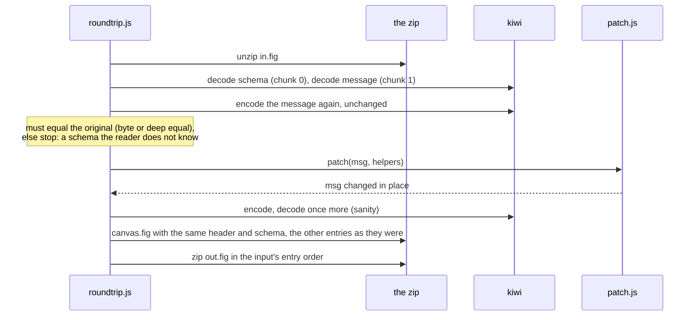
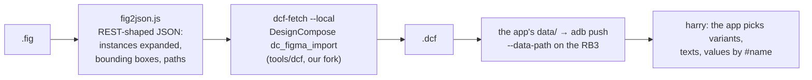

# Figma tools: AI agents generate the design, .fig to .dcf without Figma

These tools are for AI agents. An agent generates an EveryWare design: it writes the design as
code, a JavaScript *patch* that changes a Figma file at the level of its binary format (kiwi),
and the tools here apply the patch, check the result and turn it into the `.dcf` that harry
draws on the device. No one draws the screen in Figma, and no Figma account, key or token is
involved; a designer can open any built `.fig` in Figma to look at it and click its prototype.

This folder holds no design: the Library's design is in ui-lib, the panel's in smarthome-app,
each app's in its own repository.

## Who writes what



| Who | Writes | How |
|---|---|---|
| The user | what the screen is for, and picks one of the layouts the agent sketches | in the conversation |
| An AI agent | every patch: an app's screen, a Library component's drawing, the panel's screens, sheets and prototype | by the skills (new-app, ui-component, figma-design): `#<app>/*` names, Library variants only, nothing hidden |
| `scripts/new-app.sh` (ui-lib) | the first version of a new app's patch: the template's, renamed | once per app |
| `components.json` (ui-lib) | the Library's variants and transitions, which components-patch.js draws | data, read by the patch |
| A designer | a Library component drawn in Figma (`"figma": true` in components.json) | in the designers' Figma file; ui-lib's `design/fetch-library.sh` brings it into git, the build checks it against components.json (ui-lib `design/WORKFLOW.md`) |
| The designer | `Smart HOme.fig`: the drawing the panel is built on and the Library takes its icons from | in Figma, exported once |

The patches are written by hand in the sense that the agent writes them; nothing generates
them from another format.



## What is here

| File | What it does |
|---|---|
| `roundtrip.js` | Opens a `.fig`, decodes it, runs one patch on it, writes a new `.fig`. The only way a design is changed. |
| `fig-helpers.js` | The authoring API a patch uses: new frames, texts, instances, component sets, the Library's palette (`C`) and fonts (`FONT`). roundtrip.js hands it to the patch. |
| `check-figma.sh`, `check/` | Read-only checks of a built `.fig`: the Library (no set over another), the panel's contract (names under `#smarthome-root`), the prototype (every tap). |
| `fig2json.js` | A `.fig` as the Figma REST API would return it, without Figma. The input of `scripts/fig-to-dcf.sh`. |
| `json2fig.js` | The other direction: a subtree of Figma's fetched JSON as nodes in a `.fig` (`fromRest`, handed to a patch). How a component a designer drew in Figma gets into the Library. |
| `third_party/kiwi-schema` | The reader and writer of the kiwi format (MIT, Evan Wallace). |

Where the designs are:

| Project | Folder | Builds |
|---|---|---|
| The Library | `vendor/sdv-everyware/ui-lib/design` | `build-library.sh` → `design/build/library.fig` |
| The panel (smarthome-app) | `utils/smarthome-app/design` | `build.sh` → `design/build/smarthome.fig` (`--dcf`: and `data/smarthome.dcf`) |
| An app (hub, tv, pairs, a new one) | `utils/<app>-app/design` | `build.sh` → the Library, then `design/build/<app>.fig` and `data/<app>.dcf` |

## How a .fig is built



Every patch arrow is one `node roundtrip.js <in.fig> <out.fig> <patch.js>`; a project's
`design/build.sh` runs its chain. What goes in is in git (the patches, `library-base.fig`, the
designer's export); what comes out is in the project's `design/build/`, ignored by git and
written again on every build (a build is deterministic, so the same commit gives the same
bytes). Only the `.dcf` an app loads is committed, as DesignCompose apps do. The Library is built on an empty document, so an app's file carries no
other app's screen. The panel is built on the designer's drawing, which its patches turn into
slots and named texts.

## Inside a .fig, and what roundtrip.js does

A `.fig` is a zip:

```
smarthome.fig
├── canvas.fig      "fig-kiwi" + version + chunks: [0] the schema (deflate), [1] the message (zstd or deflate)
├── meta.json       file name, thumbnail size, export time
├── thumbnail.png   Figma's preview
└── images/<sha1>   image fills, by hash
```

The message is a list `nodeChanges`: every node of the document (DOCUMENT, CANVAS pages, FRAME,
TEXT, INSTANCE, SYMBOL = a component, ...), each with its `guid`, its parent (`parentIndex`:
the parent's guid and a position string that orders the siblings) and its properties. Vector
geometry sits in `blobs`, referred to by index.



The output keeps the input's entries (images, thumbnail, meta.json). roundtrip.js writes the
output path it is given, over an earlier build.

## Writing a patch

A patch is a CommonJS module that exports one function. roundtrip.js calls it with the decoded
message and `fig-helpers.js`:

```js
// <app>-app/design/<app>-patch.js
module.exports = function (msg, { key, C, FONT, authoring }) {
  const A = authoring(msg, 'myapp');                 // one tag per patch: new guids, the log
  const { nodes, kids, frame, text, instance, log } = A;
  const page = nodes.find(n => n.type === 'CANVAS' && n.name === 'Page 1');
  const variant = (set, name) => {                   // a variant of a Library component set
    const s = nodes.find(n => n.isStateGroup && n.name === set);
    return kids(key(s.guid)).find(n => n.type === 'SYMBOL' && n.name === name);
  };
  const root = frame(page, '#myapp-root', -2400, 4200, 1920, 1080, {});
  text(root, '#myapp/time', 48, 40, 400, 100, '12:41', 80, FONT.regular, C.ink);
  const slot = frame(root, '#myapp/ok', 48, 960, 200, 56, {});
  instance(slot, '#myapp/ok/preview', 0, 0, variant('#button', 'kind=primary, state=default, size=regular'));
  log(`#myapp-root: ${A.count()} nodes`);
  return msg;
};
```

What `authoring(msg, tag)` gives:

| Group | Functions |
|---|---|
| Find | `nodes` (all of them), `kids(parentKey)`, `key(guid)` |
| Make | `frame`, `rect`, `ellipse`, `text`, `arc`, `chevron`, `plus`, `instance`, `copyNode`, `base` (any node type) |
| Library | `componentSet` (a set with its variants), `meter` (a part that moves by a value), `sheetInstance`, `nameOverride` |
| Style | `solid`, `stroke`, `shadow`, `FILL`, `hugBox`, `at`, `under` |
| Report | `log`, `count()` |

New nodes get guids in a session one above the highest in the file, numbered in creation order,
and positions after the existing children. The same patch on the same input gives the same
bytes, so a build can be compared with `cmp`.

The rules a patch keeps:

- **Names are the contract.** A layer the app writes or taps is `#<app>/<part>`; the app's
  `ui_model.rs` names the same. Change both in one commit (they are in one repository).
- **Nothing hidden.** A hidden layer reaches the `.dcf` as `display: none` and harry never shows
  it. The app hides a component with opacity (`slot_shown`, `grid_shown` in ui-lib).
- **No alpha in a solid paint.** Figma drops `paint.opacity` on import: translucency is node
  opacity.
- **Library variants, not drawings.** A screen is slots with instances of Library variants; a new
  kind of control is a new Library component (ui-lib's ui-component skill).
- **Light palette.** A patch uses `C.*`; `dark-theme-patch.js` maps it to the dark theme as the
  last step.

## Using the tools

From the tree's top:

```bash
FIGMA=vendor/sdv-everyware/everyware/design/figma
U=packages/services/display_safety/utils

# an app: the Library, the app's .fig and its .dcf in one step (CHECK: names that must be in it)
CHECK='#pairs/time #pairs/cards' $U/pairs-app/design/build.sh
#   -> vendor/sdv-everyware/ui-lib/design/build/library.fig
#   -> $U/pairs-app/design/build/pairs.fig      (open in Figma to look at it)
#   -> $U/pairs-app/data/pairs.dcf              (committed, the app loads it)

# the Library alone (after a change of components.json or components-patch.js)
vendor/sdv-everyware/ui-lib/design/build-library.sh

# the panel and its checks
$U/smarthome-app/design/build.sh            # --dcf: and data/smarthome.dcf
$FIGMA/check-figma.sh $U/smarthome-app/design/build/smarthome.fig     # read only

# one step by hand, or a .fig as JSON to look at it or compare two builds
node $FIGMA/roundtrip.js <in.fig> <out.fig> <patch.js>
node $FIGMA/fig2json.js $U/pairs-app/design/build/pairs.fig /tmp/pairs-json    # /tmp/pairs-json/file.json
```

`check-figma.sh` prints `library: <n> sets, <n> problems`, `contract: ...` and the prototype's
taps, and exits 1 on a problem. `CHECK_NAMES=#a,#b` adds names that must be in the panel.

A designer can open any built `.fig` in Figma (import as a new file) to look at it and click the
prototype; the app does not need that, and no Figma key or token is involved.

## From a .fig to the device



`fig-to-dcf.sh` keeps only the root frame (`DCF_ROOT`, by default `#<out's name>-root`) and the Library's frame, with the
component sets the root uses, and checks the names in `DCF_CHECK` (0 found = misnamed or
hidden). The importer is dcf-fetch in `tools/dcf` (our fork of DesignCompose), built on the first run.

## Requirements

`node` 22.15 or newer (zstd in its zlib), `unzip`, `zip`. `fig-to-dcf.sh` also needs the tree's
cargo (`prebuilts/rust-toolchain`) and, once, the network for the importer (`tools/dcf/README.md`).

## Skills that use these tools

| Task | Skill |
|---|---|
| A new EveryWare app | ui-lib `skills/new-app` |
| A Library component | ui-lib `skills/ui-component` |
| A screen, sheet or prototype of the panel | everyware `skills/figma-design` |
