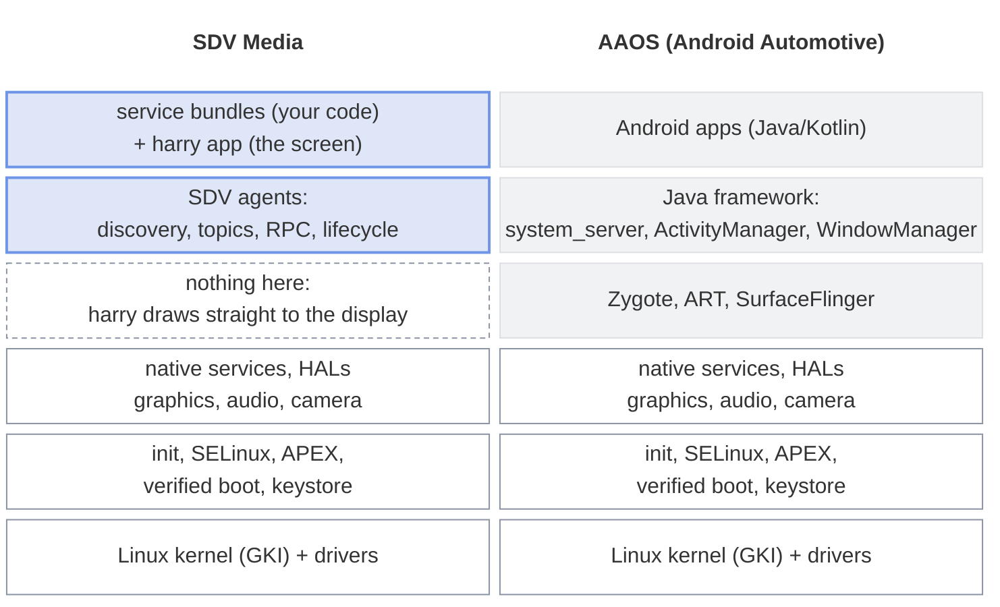

# 1. The OS: SDV Media

SDV Media is Android without the Java framework: the kernel, the system services and the update
and security machinery of Android, plus a small set of native services for devices that talk to
each other and a renderer for one screen. This page explains what is kept, what is dropped and
what that buys.

Left SDV Media, right AAOS; a row is the same layer on both sides. The bottom three rows are
identical: SDV Media keeps them from Android. Above them AAOS runs its Java framework and apps (grey),
SDV Media runs its agents, service bundles and the harry app instead (highlighted).

## Kept and dropped

| Kept from Android | Dropped |
|-------------------|---------|
| Linux kernel (GKI), drivers, HALs | Java framework (system_server and its managers) |
| bionic, init, SELinux | Zygote, ART, apps |
| APEX updates, A/B, verified boot | SurfaceFlinger, launcher, settings, app store |
| keystore, KeyMint | |

Added on top: the SDV agents (page 2) and harry, a renderer that draws one Figma design straight
to the display (page 5).

## Two flavours

| Flavour | What it contains | For | Here |
|---------|------------------|-----|------|
| **SDV Media** | the SDV services plus graphics (GPU, Vulkan/GLES), video (V4L2), audio and HAR, a renderer for the screen | devices with a screen | **used**: the panel and the second device |
| SDV Core | the same SDV services, no graphics | devices without a screen | not used here |

Nothing in it is specific to cars: a device that needs a fast, secure, updatable OS with a good
looking screen and no app store needs exactly this.

## In a car and here

In a car, SDV Media is a virtual machine. It runs on a type 1 hypervisor (QNX, Gunyah) next to
the infotainment's Android and reaches the hardware through VirtIO. Here there is no hypervisor
and no VirtIO: the SDV software boots straight on the board, with the board's own drivers.

| | In a car (Google) | Here (SDV EveryWare) |
|---|---|---|
| Runs as | a VM on a type 1 hypervisor | the only system on the board |
| Hardware | VirtIO devices: GPU, sound, disk | the board's drivers: GPU, audio, Wi-Fi |
| Kernel | GKI (6.6 by default) with VirtIO modules | GKI too (6.12), with the board's modules |
| Isolation | between the VMs | none: one system |
| The SDV software | `sdv_core_base.mk`, `sdv_samples_media.mk` | the same two |
| The device layer | `sdv_core_arm64.mk`, `sdv_media_base.mk` (the VM's graphics), `sdv_core_base/`, `sdv_core_arm64/` and `sdv_media_base/BoardConfig.mk` (the VirtIO modules) | `device-rb3` on Linaro's RB3 board support |

To run it in a VM again, swap the device layer for Google's and boot it on a board with a
hypervisor.

## Measured on the Qualcomm RB3 (2026-11-03)

Board: Qualcomm Robotics RB3 (SDA845, 8 cores, 3.5 GB RAM), image `sdv_media_db845c` userdebug,
Android 17, kernel 6.12.30 (GKI).

| | |
|---|---|
| Java framework | none (`/system/framework` is empty) |
| image (`super.img`) | 577 MB: system 144 MB, vendor 388 MB, product 32 MB. The same board with the Java framework: 1.6 GB |
| boot | `VIRTUAL_DEVICE_BOOT_COMPLETED` at 5.8 s kernel time; the SDV agents start at 5.9 to 6.1 s |
| memory in use | ~670 MB of 3.5 GB (MemTotal minus MemAvailable), with a harry process (the smarthome dashboard) running |
| processes | 45 userspace processes |

How these were taken: `getprop`, `/proc/meminfo`, `dmesg` and `ps -A -o PID,PPID,RSS,LABEL,NAME`
on the board, image sizes from the build output. The boot numbers are from the same boot as the
other values; the earliest kernel lines had already left the log buffer.

## Key terms

- **GKI**: Generic Kernel Image, Android's common kernel; the board adds only modules.
- **APEX**: Android's updatable package for system components; SDV ships service bundles in it.

## Official documentation

- [Software defined vehicle: overview](https://source.android.com/docs/automotive/sdv)
- [AAOS SDV system architecture](https://source.android.com/docs/automotive/sdv/sdv-system-architecture)
- [AAOS SDV terminology and glossary](https://source.android.com/docs/automotive/sdv/overview/terminology)
- [Get started with the software defined vehicle](https://source.android.com/docs/automotive/sdv/getting-started)
- [SDV on QNX](https://source.android.com/docs/automotive/sdv/workstreams/hardware/sdv-on-qnx): SDV Media as a VM on a type 1 hypervisor

## What's next

[2. Components](2-components.md): what runs on the device and who starts whom.
