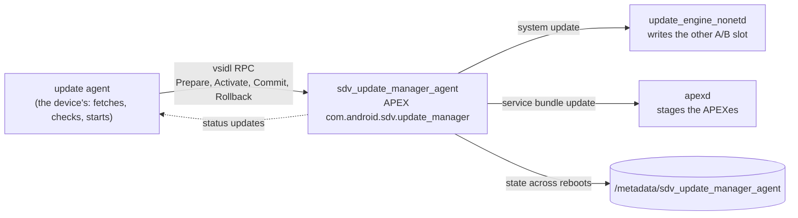
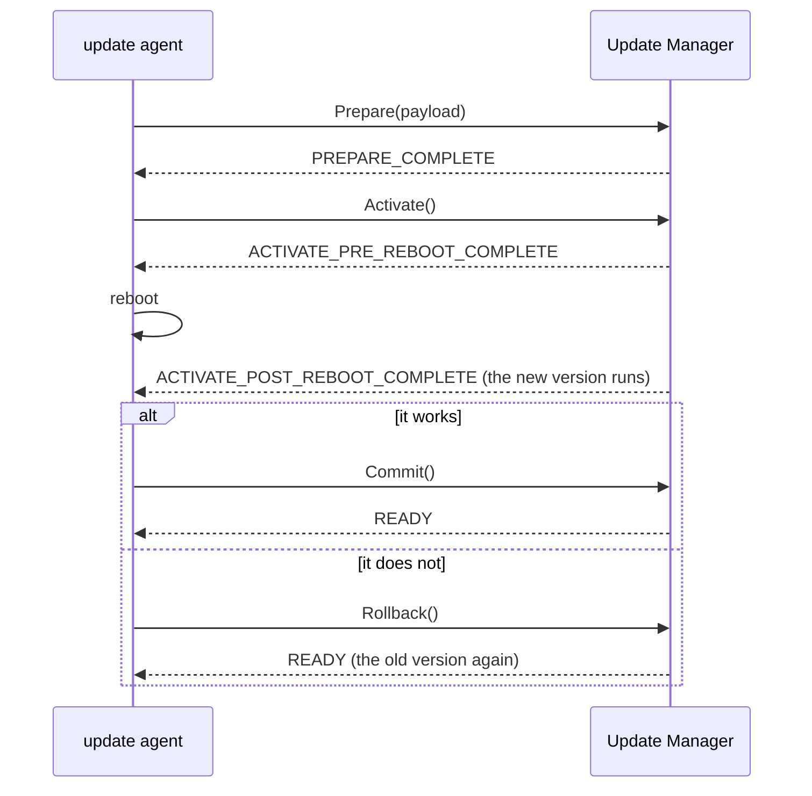

# 10. Updating the system

A device of the house is updated in two ways, through one service of SDV, the **SDV Update
Manager** (`system/software_defined_vehicle/update_manager`):

| | System update | Service bundle update |
|---|---|---|
| what changes | the partitions (system, vendor, product: the OS, the drivers, everything built in) | one or more APEXes: our service bundles and the panel's app |
| the package | an OTA zip (`m ota_from_target_files`) | the `.apex` files |
| who installs it | `update_engine`, into the other A/B slot | `apexd`, staged for the next boot |
| reboot | yes | yes |
| a failed update | the device boots the old slot again after a few failed boots | the new APEXes are dropped, the old ones are active again |

Both go through the same steps and the same states; the device's own update agent (the one that
fetches an update from the cloud) only talks to the Update Manager.

## The pieces



| Piece | Where | What it does |
|---|---|---|
| Update Manager | `system/software_defined_vehicle/update_manager` (agent, catalog with `update_manager_service.proto`) | the state machine of an update; its interface is a vsidl service, so the update agent is an SDV client like any other |
| update_engine | AOSP, started by SDV core (`update_engine_nonetd`) | applies an OTA payload to the inactive slot |
| apexd | AOSP | activates staged APEXes at the next boot |
| the update agent | the product's (an OEM's OTA client) | fetches and verifies an update, drives the steps; SDV ships a sample client (`samples/update_manager`) |

## The steps



| Step | What happens | Done when the state is |
|---|---|---|
| `Prepare(payload)` | system update: update_engine writes the payload into the other slot; service bundle update: the APEXes are checked and staged | `PREPARE_COMPLETE` (or `PREPARE_FAILURE`) |
| `Activate()`, before the reboot | the new slot or the staged APEXes are made the next boot's | `ACTIVATE_PRE_REBOOT_COMPLETE`, then the agent reboots the device |
| `Activate()`, after the reboot | the device runs the new version | `ACTIVATE_POST_REBOOT_COMPLETE` |
| `Commit()` | the new version stays | `READY` |
| `Rollback()` | the old version again, from any step before the commit | `READY` |

Every request returns at once when it is accepted; its result is the state the Update Manager
reaches, which the agent follows with `SubscribeToStatusUpdates()` or `GetStatus()`. A system
update can be suspended and resumed while it is prepared (`Suspend()`, `Resume()`), and an
installed APEX update can be removed again (`UninstallApex()`).

**A failed boot rolls back by itself.** A service bundle update carries `boot_attempts`: every
boot that does not reach the new version's activation counts down, at 0 the update is dropped
and the old APEXes are active again. A system update that does not boot falls back to the old
A/B slot the same way. A device is never left on a version that does not start.

## On the RB3 today

| | State |
|---|---|
| Update Manager | in the image (SDV core), running, its state in `/metadata/sdv_update_manager_agent` |
| update_engine | in the image, running |
| partitions | A/B with virtual A/B (`ro.boot.slot_suffix`, `ro.virtual_ab.enabled=true`) |
| system updates | possible: an OTA zip of the product through the Update Manager |
| service bundle updates of our APEXes | not possible yet: every APEX of ours is `updatable: false` (bundles and the panel), so apexd takes a new version only with a system update |
| signing | every APEX of ours is signed with the test keys of its `apex/` folder (public repository): a product needs keys of its own, also for the OTA |
| update agent | none yet; the SDV sample client (`sdv_update_manager_client`) is not in the image (`sdv_samples_core.mk`) |

A service bundle update needs its APEX built `updatable: true` with a version that goes up with
every release, signed with the product's key. The image the device runs decides which keys are
accepted.

`scripts/deploy-bundle.sh` (`--target rb3` or `--target cf`) is not an update: it writes an APEX
over the one in the image (remount) for development, without the Update Manager's steps or a
rollback.

## Not for updates: apexd's rebootless install

apexd can also swap a mounted APEX at run time (Android's rebootless APEX install). On SDV it is
not documented and not part of the update path: the bundles keep running the old code until the
lifecycle manager restarts them, nothing rolls back, one APEX goes per call, and an APEX shared
by several bundles needs a forced install. The Update Manager's staged update has none of these
gaps.

## Checking it

```bash
# WHAT: the slot the device runs and whether it is A/B
adb shell getprop ro.boot.slot_suffix; adb shell getprop ro.virtual_ab.enabled
# WHAT: the Update Manager and update_engine are running
adb shell ps -A | grep -E 'sdv_update_manager_agent|update_engine'
# WHAT: what they log during an update
adb logcat -s update_manager update_engine apexd
```

The update itself, step by step with the sample client: `samples/update_manager/SYSTEM_UPDATE.md`
and `SERVICE_BUNDLE_UPDATE.md` in `system/software_defined_vehicle`.

## Key terms

- **A/B slots**: two copies of the partitions; an update writes the inactive one, the next boot
  takes it, a failed boot returns to the other. Virtual A/B keeps the second copy as a snapshot
  instead of a full partition.
- **OTA payload**: the update of the partitions, built from the product's target files.
- **Staged APEX**: an APEX installed for the next boot, active only after it.
- **`boot_attempts`**: how many boots a service bundle update gets to come up before it is
  dropped.

Related: [1. The OS](1-the-os.md), [3. Service bundles](3-service-bundles.md),
[6. Security](6-security.md), [9. Starting the app](9-starting-the-app.md).
