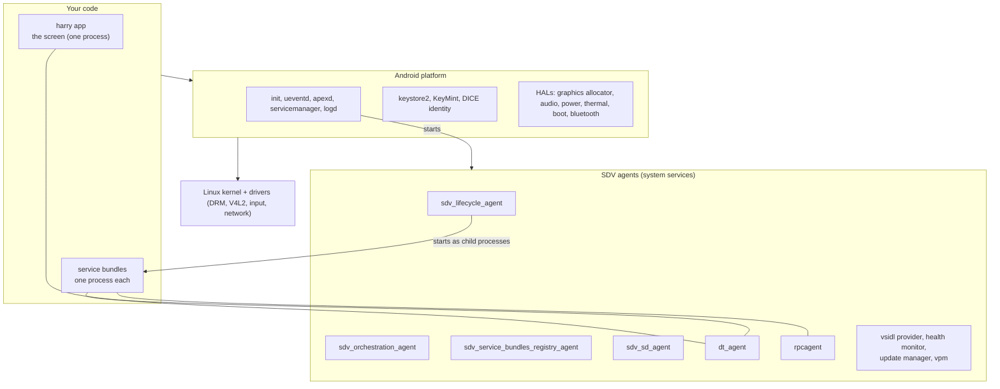
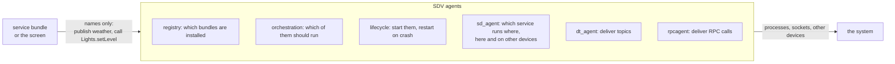

# 2. Components

What runs on an SDV Media device, in layers, and who starts whom. Memory sizes are measured
([1. The OS](1-the-os.md), section Measured).

## The SDV agents

The SDV agents are the system services of SDV Media. They take the place of Android's Java
framework (system_server and its managers), but they do a much smaller job: they run the
service bundles and connect them. init starts them from their `.rc` files at boot, they run all
the time, each in its own process and SELinux domain, and they are
written mostly in Rust.

A bundle or the screen never deals with processes, sockets or other devices. It only uses names
("the topic `weather`", "the service `Lights`"), and the agents do the rest:

Without the agents a bundle is only a library; with them it becomes a running service that other
bundles, the screen and other devices can find by name.

| Process | Job | Language | Memory (RSS) |
|---------|-----|----------|------------|
| `sdv_lifecycle_agent` | starts, stops and restarts service bundles; they run as its child processes | Rust | 13 MB |
| `sdv_orchestration_agent` | decides which bundle instances should run (orchestration configs) | Rust | 15 MB |
| `sdv_service_bundles_registry_agent` | knows which bundles are installed (from the APEX manifests) | Rust | 8 MB |
| `sdv_sd_agent` | service discovery: which services run here and on the other devices | Rust | 18 MB |
| `dt_agent` | carries topics (publish/subscribe) | C++ | 14 MB |
| `rpcagent` | carries RPC calls | C++ | 5 MB |
| `sdv_vsidl_provider_agent` | serves the interface definitions (vsidl) | Rust | 18 MB |
| `sdv_health_monitor`, `sdv_update_manager_agent`, `sdv_vpm_agent` | health, updates, power modes | Rust | 13 to 16 MB |

All agents are started by init from their `.rc` files, each in its own SELinux domain
(`sdv_lc_default`, `sdv_orch`, `sdv_sd_default`, `sdv_dt_agent`, ...).

## Service bundles

The code of a device: one bundle per function, each a separate process started by the lifecycle
agent (parent PID = lifecycle agent), in the SELinux domain `untrusted_service_bundle`. For
example: `HarSdvVehicleDataPublisher` (24 MB), `HarSdvServiceBundle` (31 MB),
`HarSdvFakeVehicleDataPublisherServiceBundle` (26 MB). See
[3. Service bundles](3-service-bundles.md).

## The screen

One harry process owns the display (DRM master): it draws a Figma design with the GPU and takes
the touch input. Such a process uses about 100 MB (measured with the smarthome dashboard,
2026-11-03), most of it GPU buffers, the design and the fonts. See [5. UI](5-ui.md).

## Android platform underneath

`init`, `ueventd`, `apexd`, `vold`, `servicemanager`, `logd`, `keystore2`, KeyMint, the HALs. They
are the same binaries as on any Android device, 3 to 14 MB each.

## Key terms

- **Agent**: a system service of SDV, started by init, always running.
- **Service bundle**: application code, installed as part of an APEX, started by the lifecycle agent.

## Official documentation

- [Logical architecture: agents, packages, service bundles](https://source.android.com/docs/automotive/sdv/core-areas/what-service)
- [Configure the Orchestrator](https://source.android.com/docs/automotive/sdv/core-areas/orchestrator)
- [Control vehicle and power management (VPM agent)](https://source.android.com/docs/automotive/sdv/core-areas/power-management)
- [Automotive services: configuration, diagnostics, user preferences](https://source.android.com/docs/automotive/sdv/core-areas/automotive-services/overview)

## What's next

[3. Service bundles](3-service-bundles.md): what a bundle is made of.
