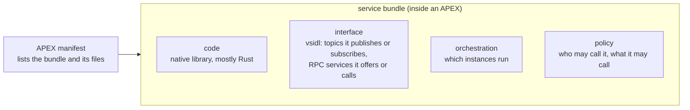
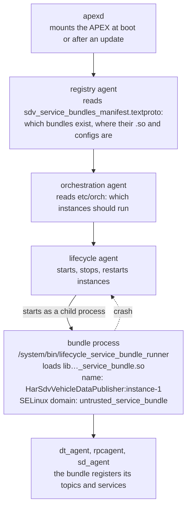
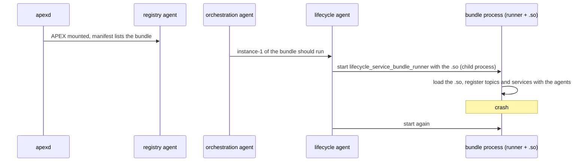

# 3. Service bundles

A service bundle is the unit of function on an SDV device: "the lights", "the weather", "the
door lock". It is installed inside an APEX and made of four parts.



## Two ways to talk

| Way | Pattern | For | House example |
|-----|---------|-----|---------------|
| **Topic** | one publishes a value, any number subscribe | data that keeps changing | room temperature, weather |
| **RPC** | ask a named service to do something, get an answer | commands | "turn on the light", "unlock the door" |

A bundle never shares memory with another and never calls it directly. It only uses names: the
topic `weather`, the service `Lights`. Where the other side runs is the [agents'](2-components.md#the-sdv-agents) business.

## The four parts, from a real bundle

The vehicle data publisher in the tree (`packages/services/display_safety/service/`) shows every
part. The house bundles will look the same with other names.

**Interface (vsidl)**: what the bundle publishes, `service/vehicledata/sdv_vehicledata_catalog_v1/vehicledata_system.vsidl`:

```
package: "com.sdv.google.display_safety"

sdv_service_bundle {
    name: "HarSdvVehicleDataPublisher"
    publisher {
        type: "VehicleSpeed"          # protobuf message
        topic: "vehicle-speed"
        topic: "max-speed"
        topic: "speedlimit"
        capacity: 100
    }
    ...
}
```

**APEX manifest**: where the library and the configs are,
`service/product/har_sdv_service_bundle_apex/har_sdv_vehicle_data_publisher_service_bundle.manifest.textproto`:

```
sdv_service_bundle_metadata {
  name: "HarSdvVehicleDataPublisher"
  version_number: 1
  native_library_path: "lib64/libhar_sdv_vehicle_data_publisher_service_bundle.so"
  orchestration_config_path: "etc/orch/VehicleDataServiceBundleOrchestration.textproto"
  authorization_policy_path: "etc/acls/har_sdv_vehicle_data_publisher_acl.textproto"
}
```

**Orchestration**: which instances run, `VehicleDataServiceBundleOrchestration.textproto`:

```
instance: "instance-1"
service_bundle_name: "HarSdvVehicleDataPublisher"
package_name: "com.sdv.google.display_safety"
state { instances_states { started: "instance-1" } }
```

**Policy**: what a bundle may use, `acl_configs/har_sdv_service/acl.textproto`
(the consumer side):

```
server {                       # offers this RPC service
  service: "com.sdv.google.display_safety.DriverUIService"
  channel: "com-sdv-google-display-safety-driver-ui-service"
}
subscriber {                   # may subscribe to these topics
  message: "com.sdv.google.display_safety.VehicleSpeed"
  topic: "com-sdv-google-display-safety-vehicle-speed-vehicle-speed"
}
```

## Who starts and manages a bundle

A bundle cannot start itself: it is a library. Four parts of the system turn it into a running
process, and one of them, the [lifecycle agent](2-components.md#the-sdv-agents), keeps it running.



| Who | Does | Process |
|-----|------|--------------------|
| apexd | mounts the APEX that carries the bundles | `apexd` |
| [registry agent](2-components.md#the-sdv-agents) | knows which bundles are installed | `sdv_service_bundles_registry_agent` |
| [orchestration agent](2-components.md#the-sdv-agents) | decides which instances should run now | `sdv_orchestration_agent` |
| [lifecycle agent](2-components.md#the-sdv-agents) | starts every instance as its own child process, restarts it after a crash, stops it | `sdv_lifecycle_agent` (parent of every bundle process) |
| the runner | the program the bundle process actually runs; it loads the bundle's `.so` | `lifecycle_service_bundle_runner` |

The same steps over time:



An update replaces the APEX; the bundle restarts with the new code. Other bundles and the screen
keep running.

## What is on the device

At runtime a bundle is one shared library plus three text configs, all inside an APEX. One APEX can
carry several bundles. For example (`/apex/com.sdv.google.display_safety`):

```
/apex/com.sdv.google.display_safety/
├── lib64/
│   ├── libhar_sdv_vehicle_data_publisher_service_bundle.so      the code of one bundle
│   ├── libhar_sdv_service_bundle.so                             another bundle
│   └── libhar_sdv_fake_vehicle_data_publisher_service_bundle.so another bundle
└── etc/
    ├── sdv_service_bundles_manifest.textproto                   every bundle of this APEX: name,
    │                                                            version, paths to its .so and configs
    ├── orch/VehicleDataServiceBundleOrchestration.textproto     which instances run
    └── acls/har_sdv_vehicle_data_publisher_acl.textproto        its policy (authz)
```

| Artifact | What it is | Made from | Read by |
|----------|------------|-----------|---------|
| `lib…_service_bundle.so` | the code, mostly Rust | the bundle's source + the Rust API generated from its vsidl | `lifecycle_service_bundle_runner` (loads it) |
| `sdv_service_bundles_manifest.textproto` | the list of bundles in this APEX | written by hand | [registry agent](2-components.md#the-sdv-agents) |
| `etc/orch/….textproto` | instances to run | written by hand | [orchestration agent](2-components.md#the-sdv-agents) |
| `etc/acls/….textproto` | topics and services the bundle may use | written by hand | [the SDV agents](2-components.md#the-sdv-agents), to check every subscription and call (authz) |

The vsidl is not shipped as a file: at build time it is compiled into a typed Rust API (publishers,
subscribers, RPC clients and servers) that is linked into the `.so`.

## Key terms

- **vsidl**: SDV's interface definition: messages (protobuf), topics, RPC services of a bundle.
- **Instance**: one running copy of a bundle (`instance-1`).
- **Channel**: the name an RPC service is reached by (`driver-ui-service`).

## Official documentation

- [Quick start: create and execute SDV service bundles](https://source.android.com/docs/automotive/sdv/workstreams/core/service-bundle-development)
- [AAOS SDV terminology and glossary](https://source.android.com/docs/automotive/sdv/overview/terminology)
- [Configure the Orchestrator](https://source.android.com/docs/automotive/sdv/core-areas/orchestrator)
- [Update Manager (APEX updates, rollback)](https://source.android.com/docs/automotive/sdv/core-areas/sdv-update-manager)
- [Android Studio for Platform](https://developer.android.com/studio/platform)

## What's next

[4. Communication](4-communication.md): how the names become connections, on one device, between
devices and to the internet.
