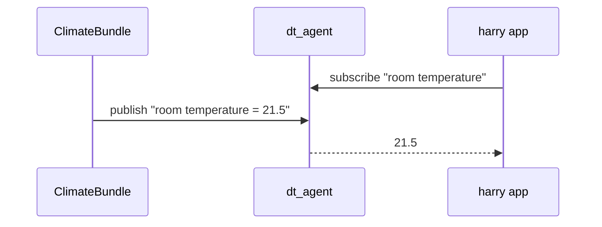
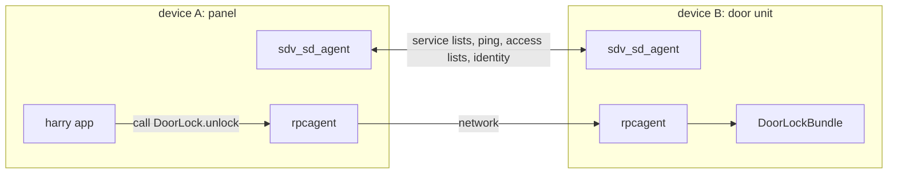
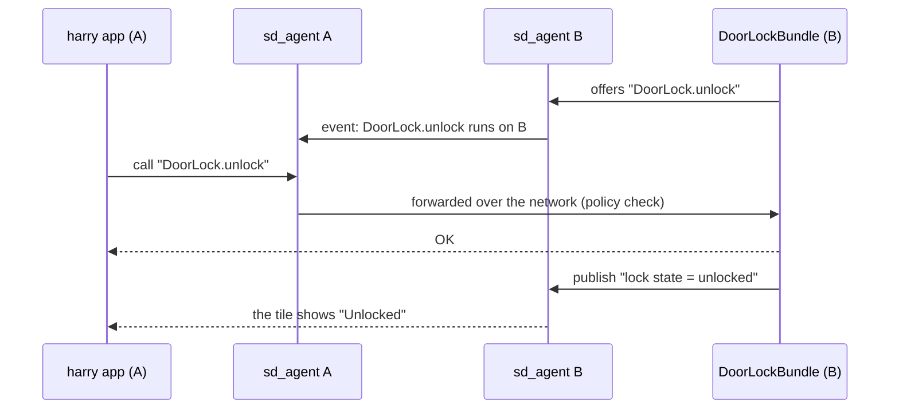
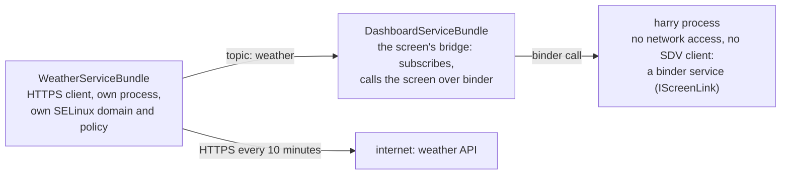
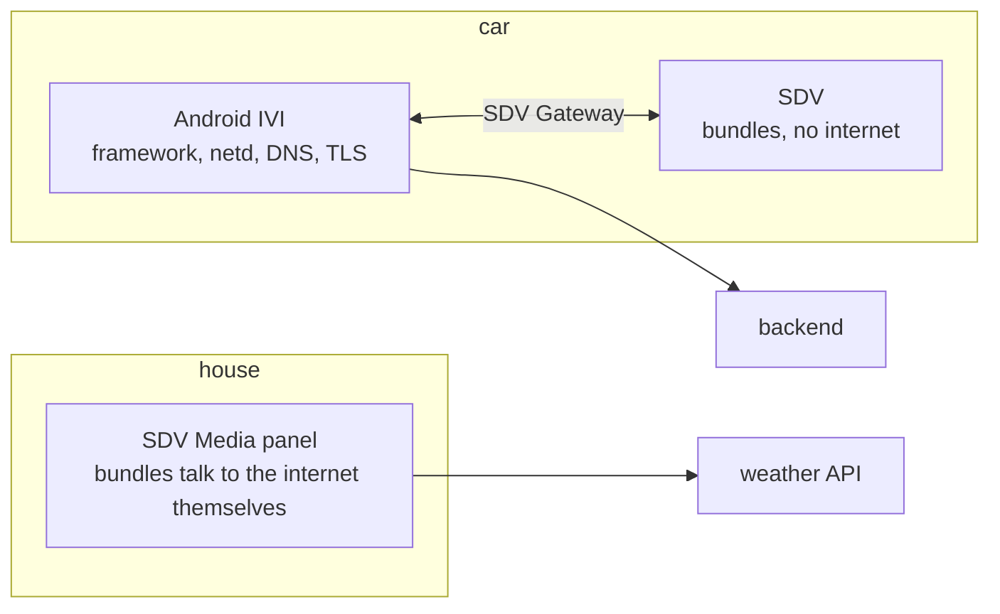

# 4. Communication

Bundles and the screen only use names. The agents turn a name into a connection: (a) on the same
device, (b) between devices, (c) to the internet through a bundle.

## a) On one device

The publisher and the subscriber never see each other; both talk to `dt_agent`.

RPC works the same way through `rpcagent`: the caller asks for a service by name, `rpcagent`
finds which bundle offers it and forwards the call.

### Topic or RPC

The two are not two directions; they are two kinds of exchange, and a bundle often has both.

| | Topic | RPC |
|---|---|---|
| direction | one way: the publisher to every subscriber | both ways on one call: the request to the server, the answer to the caller |
| for | a state that changes on its own (a reading, a connection, a lock) | a command with an outcome (join this network, unlock the door) |
| a lost message | the next update replaces it | the call fails for its caller (no server, the deadline) |
| who learns | everybody who subscribed, also later screens, loggers, automations | only the caller, only about its call |

A command changes a state, so the outcome usually shows twice: as the answer for the caller and
as an update of the topic for everybody. What happens without a command (the access point goes
away, the device joins a saved network after a boot) shows only on the topic. The Wi-Fi bundle
is the example in the tree: `WifiService` for the commands, `wifi-networks` and `wifi-state`
for what it sees (`bundles/wifi/README.md`).

## b) Between devices

The `sdv_sd_agent` of every device connects to the `sdv_sd_agent` of every other device. Together
they form a mesh that keeps one picture of "which service runs where".

What the agents do, step by step:

1. **Who are my peers?** Each device has a list of the other devices (today a static list,
   `vvm_config`). Devices do not find each other by themselves; see
   [open points: device discovery](../project/open-points.md).
2. **What runs where?** Each `sdv_sd_agent` subscribes to the service list of every peer: a
   snapshot first, then an event whenever a service appears or disappears.
3. **Is the peer still there?** A periodic ping; a device that stops answering is removed and its
   services disappear everywhere.
4. **May I?** The agents exchange their access lists, so a call from another device is checked
   like a local one.
5. **Who are you?** Every device has a cryptographic identity (DICE); devices know whom they talk
   to.

A call across devices:

The code of the screen is the same whether the lock runs on the panel or on another device.

Measured between two Cuttlefish VMs on one laptop (2026-10): an RPC from Android in one VM to a
bundle in the other answered in 49 ms.

## c) To the internet

Only bundles talk to the internet; the screen never does.

The harry process cannot subscribe itself: the middleware client exists only inside a bundle
the lifecycle agent started. The bridge bundle subscribes for it and pushes every update over
binder (`interfaces/screen`: the screen takes a call only from this bundle). HAR's own
`HarSdvServiceBundle` does the same for `harry-app` over a local gRPC connection
(`packages/services/display_safety/utils/smarthome-app/docs/harry-app-anatomy.md`).

| Why in a bundle | |
|---|---|
| isolation | a hung request or a crash in the TLS stack hits the bundle, not the process that draws the screen; the lifecycle agent restarts the bundle |
| security | one small process gets network access; a bug in a parser does not reach the screen and the touch input |
| reuse | the `weather` topic is there for every screen, every device and AI agents |
| tests and demos | a mock bundle publishes the same topic without a network |

The same holds for device protocols: MQTT, Zigbee or a cloud API each live in their own bundle.

### How SDV does it in a car, and why we cannot

SDV has no example of a bundle talking to a backend, and stock SDV Media has no netd and no
DNS resolver. In a car this is by design: the Android side (IVI, with the framework) is the
one on the internet, and SDV services reach it over the SDV Gateway
(`system/software_defined_vehicle/samples/sdv_gateway`).

A house has no Android device to lean on, so the panel goes to the internet itself. What that
takes is in [7. Extensions](7-extensions.md): the network bring-up of the device's product, a
DNS daemon, and HTTPS on the platform's TLS stack.

## Key terms

- **Mesh**: the `sdv_sd_agent`s of all devices, connected to each other.
- **Peer**: another device in the mesh.
- **DICE**: Device Identifier Composition Engine, the identity a device proves itself with.

## Official documentation

- [VSIDL and middleware overview](https://source.android.com/docs/automotive/sdv/core-areas/vsidl)
- [Communications authorization overview](https://source.android.com/docs/automotive/sdv/workstreams/core/comms-authorization/overview)
- [Mesh status and provisioning (service discovery between VMs)](https://source.android.com/docs/automotive/sdv/workstreams/core/vm-attestation/provisioning)
- [Use the SDV Gateway on IVI](https://source.android.com/docs/automotive/sdv/sdv-gateway-on-ivi)
- [SOME/IP integration overview](https://source.android.com/docs/automotive/sdv/some-ip-integration)

## What's next

[5. UI](5-ui.md): how the screen is built.
