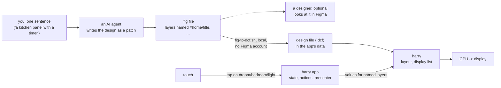

# 5. UI: a design file and harry

The screen of an SDV Media device is always a design file. There is no layout code and no drawing
API: the design says what is on the screen, harry draws it on the GPU, and the app only says which
values change. Nobody has to draw the screen by hand: an AI agent writes the design, and a
designer can open the built `.fig` in Figma to look at it and click its prototype.

## Why a design file is required

harry has no API to place or draw elements. Everything visible comes from the design: positions,
sizes, colours, fonts, images, components and their variants. The app can only change what the
design already has: a text, a visibility, a variant, a position, the items of a list, an image.
The image is the one place pixels come from the app: a camera frame, or an external GL renderer
drawing into a texture that harry composes into that layer; the design still says where and how
big.

The design does not have to come from Figma's servers:

| Way | Who | How |
|---|---|---|
| **Agentic** (the default) | an AI agent, following a skill (`new-app`, `ui-component`, `figma-design`) | it writes the screen as a patch of Library components and builds the `.fig` (`design/figma`) |
| **From the local `.fig`** | the build of any app | `scripts/fig-to-dcf.sh` turns the `.fig` into the `.dcf` on your machine: no import, no file key, no Figma account or token |
| **Drawn by hand in Figma** | a designer | `scripts/fetch-dcf.sh` fetches the file through Figma's API, with its file key and a token. A Library component drawn in Figma comes in with ui-lib's `design/fetch-library.sh` |

| | |
|---|---|
| the look lives in one place | what is in the design is what is on the screen |
| a new look needs no code change | a new `.dcf` |
| the app stays small | state, actions, presenter and the layer names; a first screen is a few hundred lines including the build file |
| the cost | every element the code changes must exist in the design with a `#name` |

## The contract between design and code

The **layer name** is the contract. A layer `#home/title` in Figma and the field
`#[Design(node = "#home/title")] title: String` in the app are the same element.

- Only layers the code touches need a `#name`.
- A hidden layer is not in the `.dcf`, so the code cannot reach it.
- The root frame has the display size (for example 1920x1080) and its name is configured in the app.
- Every font face the design uses must be loaded by the app.

## What the app can change

| In the app | On the screen |
|------------|---------------|
| text | the text of a layer |
| visible / gone | show, hide, remove from the layout |
| variant | another state of a component (pressed, on/off) |
| position | moves a layer (cheap, no new layout) |
| size | resizes a layer (new layout) |
| list | fills a frame with copies of a template layer |
| image, camera frame | the content of an image layer |
| tap | the name of the layer that was tapped |

## How a frame is made

1. Something happens (a tap, a timer, a topic update): an **action**.
2. The action changes the app's **state**.
3. The **presenter** turns the state into values for the named layers.
4. harry applies them to the design, lays it out, builds the draw commands and the GPU draws.

harry reuses the previous layout when only positions and visibilities change; that is what keeps
animations at 60 frames per second.

How to write such an app, step by step, with every file:
`packages/services/display_safety/utils/smarthome-app/docs/harry-app-anatomy.md`.

## Key terms

- **harry**: the renderer of HAR (High Availability Renderer); one process owns the display.
- **.dcf**: the design as harry reads it, a serialized Figma document, built locally from a `.fig`.
- **Presenter**: the function that turns the app state into values for the layers.

## Official documentation

- [Display Safety: the high availability renderer (HAR)](https://source.android.com/docs/automotive/sdv/display-safety)
- [Get started with Display Safety](https://source.android.com/docs/automotive/sdv/display-safety/get-started)

## What's next

[6. Security](6-security.md): who may do what. The controls themselves, drawn once and used
everywhere: [8. UI components](8-ui-components.md).
