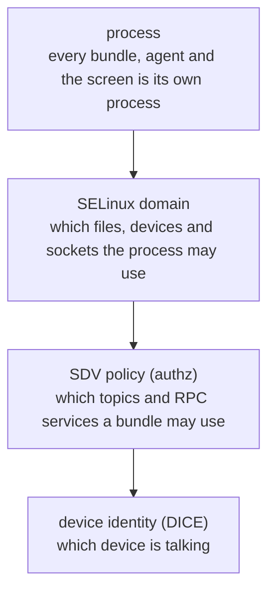

# 6. Security

Four layers decide what a piece of code may do. They come from Android and SDV; none of them has
to be built for this project.

| Layer | Protects against | Today |
|-------|------------------|------------------|
| process | a crash or a memory bug spreading | yes: 45 processes, bundles are separate children of the lifecycle agent |
| SELinux | a process touching what it does not need (another process's files, the network, the display) | domains exist (`untrusted_service_bundle`, `sdv_dt_agent`, `sdv_sd_default`, ...), but the board runs in **permissive** mode (bring-up): violations are logged, not blocked |
| SDV policy | a bundle using a topic or service it was not given | yes, per bundle (`permissions.textproto`) |
| DICE identity | a foreign device joining the mesh | yes, but from test files (`init_open_dice_from_file`), as on Cuttlefish |

## The network boundary

Only bundles that need the network get it; the screen never does
([4. Communication](4-communication.md), part c). Today SELinux is permissive, so this
boundary is a design rule, not yet an enforced one.

## Updates

System parts and bundles are updated as APEX packages, signed and verified by Android; the board
keeps two slots (A/B) and falls back if a new image does not boot.

## What is not done yet

| | |
|---|---|
| SELinux in enforcing mode | needs the denials of the permissive runs fixed first |
| a real device identity | DICE from test files today |
| a policy for network access of bundles | WeatherBundle will be the first |

## Key terms

- **Permissive / enforcing**: SELinux logs violations / blocks them.
- **authz**: SDV's authorization policies, one per bundle.

## Official documentation

- [Authorization policy (permissions.textproto)](https://source.android.com/docs/automotive/sdv/workstreams/core/comms-authorization/authz-policy)
- [Communications authorization overview](https://source.android.com/docs/automotive/sdv/workstreams/core/comms-authorization/overview)
- [Mesh status and provisioning (service discovery between VMs)](https://source.android.com/docs/automotive/sdv/workstreams/core/vm-attestation/provisioning)
- [Update Manager (APEX updates, rollback)](https://source.android.com/docs/automotive/sdv/core-areas/sdv-update-manager)
- [A/B system updates](https://source.android.com/docs/automotive/sdv/workstreams/core/system-updates)

## What's next

[7. Extensions](7-extensions.md): what we add to the stock OS.
