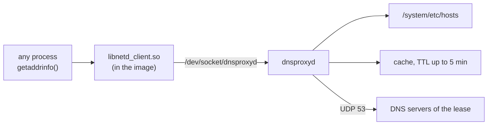
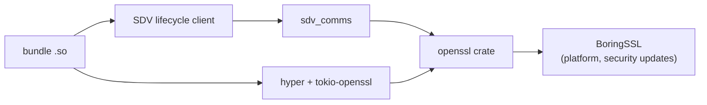
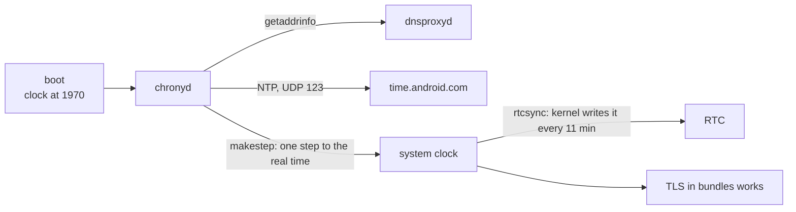

# 7. Extensions

SDV Media is built for a car: the computers and their addresses are fixed at the factory, and
nothing on them looks up a name on the internet. A device in a house joins whatever network is
there and talks to cloud services. This page lists what we add to the stock OS for that, why,
and where it lives.

Service bundles are not on this list: they use the stock mechanism
([3. Service bundles](3-service-bundles.md)).

| Extension | What it adds | Where in the tree |
|-----------|--------------|-------------------|
| [dnsproxyd](#name-resolution-dnsproxyd) | `getaddrinfo()` resolves names in every process | `vendor/sdv-everyware/dnsproxyd`, its own repository |
| [HTTPS from a bundle](#https-from-a-bundle) | a bundle calls a web API | in the bundle, on SDV's own TLS stack |
| [System time: chrony](#system-time-chrony) | the clock is right after boot | `vendor/sdv-everyware/third_party/chrony`, upstream chrony with an Android build |

## What a device product provides

Bringing up the network is not part of this project: it depends on the hardware (which
interfaces, which drivers, which firmware), so each device's product does it. Every device
provides the same three things:

| | |
|---|---|
| interfaces up after boot, with DHCP | an address and a default route without the framework |
| the DNS servers of the lease | as the properties `vendor.net.<if>.dns1..4`, for dnsproxyd. This is how AOSP's own products without the framework do it: `dhcpclient` (`device/generic/trusty/dhcp/client`) publishes them on Trusty QEMU and goldfish, with its SELinux policy (`device/generic/trusty/sepolicy/dhcpclient.te`) and the properties as `vendor_restricted_prop` (`device/generic/goldfish/sepolicy/vendor/property.te`); another client sets them the same way |
| Wi-Fi credentials outside the image | created on the device |

The RB3 does it with a oneshot service and AOSP's `dhcpclient`: section "Network" of
`device/rb3/sdv_media_db845c/README.md`.

## Name resolution: dnsproxyd

On Android a process does not resolve names itself. `getaddrinfo()` in bionic sends the query
over `/dev/socket/dnsproxyd` to netd, netd passes it to DnsResolver (APEX `com.android.resolv`),
and DnsResolver knows the DNS servers because ConnectivityService (Java) told it after DHCP.
`/etc/resolv.conf` is ignored on purpose.

SDV Media has none of these: no netd, no `com.android.resolv`, no framework. Even
`update_engine` is built in its `nonetd` variant. In a car this is fine; here every name lookup
fails.

dnsproxyd is a small daemon on the same socket that speaks netd's protocol. bionic cannot tell
the difference, so every program resolves names again without a change, including a bundle
that uses an ordinary HTTP client.

### Why not the stock stack, why not a resolver per bundle

| | Stock netd + DnsResolver | A resolver in each bundle | dnsproxyd |
|---|---|---|---|
| What | APEX `com.android.tethering` (eBPF loader, `libnetd_updatable`), APEX `com.android.resolv`, netd, and our own binder client in place of ConnectivityService | each bundle that needs the internet carries its own DNS client | one daemon on netd's socket |
| `getaddrinfo()` in every process | yes | no, only inside the bundle | yes |
| Without the framework | netd expects ConnectivityService: it is told over binder which networks, routes and DNS servers exist; its start is chained to the eBPF loader | yes | yes |
| Side effects | netd installs policy routing (fwmark rules): routes set by the board no longer apply, the network bring-up would have to go through netd | none | none |
| Size | three APEXes, eBPF on the board's kernel, SELinux for netd | about 100 lines per bundle | about 300 lines, one process |

The stock stack makes sense once a device needs what netd is for: a firewall, per-app networks,
VPN, tethering. A resolver per bundle was our first step for WeatherBundle; it does not help any
other program on the device, and every new bundle would copy it.

### Limits

- Only `getaddrinfo` and `gethostbyname` are served; `gethostbyaddr` and `resnsend` fail.
- IPv4 first: AAAA records are asked only when a name has no A record, because the devices get
  IPv4 leases.
- No DNS-over-TLS, no search domains, no DNSSEC.

## HTTPS from a bundle

A bundle that calls a web API uses the HTTP and TLS libraries SDV itself uses for SDV-RPC
(`system/software_defined_vehicle/middleware/sdv_comms/sdk/rs/rpc/tls.rs`): hyper over
tokio-openssl over the `openssl` crate, which is BoringSSL, the platform's crypto library.

The server certificate is checked against the system CA store
(`/system/etc/security/cacerts`) and the host name; names resolve through `getaddrinfo()`, so
through dnsproxyd.

### Why not reqwest

reqwest, the usual Rust HTTP client, brings a second TLS stack (rustls over aws-lc-rs). On
Android both stacks sit on the same Rust binding of BoringSSL (`bssl_sys`, built as an rlib
only), so a bundle that has both cannot be linked as a shared library: either the build fails
(the binding twice) or, linked statically, the bundle loses the SDV libraries it needs at load
time (`dlopen failed: cannot locate symbol ASDV_ServiceFqin_toString`). One TLS stack per
process, the one SDV already loads, avoids both.

### Where the code lives

Under `vendor/sdv-everyware/`, the AOSP place for product code. `libopenssl` is visible to
`//vendor:__subpackages__`; the tree's `libtokio_openssl` is visible only to SDV's comms SDK,
so `third_party/rust` carries its own copy of the crate, `libtokio_openssl-ew`, next to the
crates of rs-matter.

## System time: chrony

TLS needs the right time: a certificate is valid from one date to another. The RB3 has no
battery for its real-time clock and boots at 1970-01-01, so every certificate is "not yet
valid" and the handshake fails (`CERTIFICATE_VERIFY_FAILED`).

On Android the framework sets the time over NTP (`NetworkTimeUpdateService`); in a car SDV
gets it from the vehicle network. Neither is there in a house. AOSP has no native NTP daemon
(toybox's `sntp` is in the sources but switched off), so we build chrony, the NTP
implementation of most Linux distributions and embedded Linux builds.

On the RB3: `System clock wrong by 1793692493.65 seconds`, stepped, and two seconds later
WeatherBundle got the weather over HTTPS.

| Setting | Why |
|---------|-----|
| `pool time.android.com` only | the servers Android itself uses; Google smears leap seconds, so they are not mixed with other pools |
| `makestep 1 3` | step the clock on the first three updates (1970 to now at once), slew afterwards |
| `rtcsync` | the kernel keeps the RTC in step |
| runs as `system` with `CAP_SYS_TIME` only, `user system` | one privilege: setting the clock |
| `cmdport 0` | `chronyc` only through the local Unix socket |
| `chrony_refresh.sh <if>` on the DHCP lease | chronyd starts before the network and, after its first failed name resolution, retries only minutes later. init runs the script on the property `vendor.net.<if>.dns1` (dhcpclient's lease): it waits for the default route, `chronyc refresh` makes chronyd resolve its servers again, repeated until it has sources. The clock leaves 1970 within seconds of the lease |

### The Android build

The sources are upstream chrony 4.9, unchanged (signature checked, see `METADATA`). The
Android parts are next to them:

| File | What |
|------|------|
| `Android.bp` | `chronyd`, `chronyc` and `chrony_refresh.sh`, the file lists of the configured Makefile |
| `android/config.h` | instead of `./configure`, which runs on the build host and cannot see bionic: generated once with the options above, every `HAVE_` checked against bionic |
| `android/bionic_compat.h` | `ethtool_cmd_speed()`: bionic's copy of the kernel headers drops static inline functions |
| `include_build_directory: false` | chrony has its own `sched.h`, which would hide libc's `<sched.h>` from bionic's `pthread.h` |
| `android/chrony.conf`, `android/chronyd.rc`, `android/sepolicy/` | configuration, service, domain `sdv_chronyd` |

## Shortcuts to remove

| | Today | Proper way |
|---|---|---|
| SELinux | `sdv_dnsproxyd` (and the RB3's `net_bringup`) are permissive domains | policy written from the denials of a running device |
| DNS servers | dnsproxyd (system side) reads a file in `/data/vendor` | a Treble-clean handover, for example a property the board's init sets |
| Socket mode | `0666` instead of netd's `0660 root inet` | bundles get the `inet` group |
| `tokio-openssl` visibility | local one-line change in `external/` | the same line upstream |
| NTP not authenticated | chrony without NTS, a spoofed answer at boot could set a wrong time | NTS (RFC 8915): needs GnuTLS or a BoringSSL backend for chrony |
| SELinux for chrony | `sdv_chronyd` is permissive | policy from the denials |

## Key terms

- **netd**: Android's network daemon: routing, firewall, DNS proxy. Not part of SDV Media.
- **DnsResolver**: the resolver module (`com.android.resolv`) that netd uses.
- **DHCP lease**: the address, router and DNS servers a router hands out.
- **NTP**: Network Time Protocol. **NTS**: its authenticated variant.
- **RTC**: the real-time clock chip that keeps the time while the device is off.

## What's next

How this is used in the house: [devices and dashboard](../solution/devices-and-dashboard.md).
