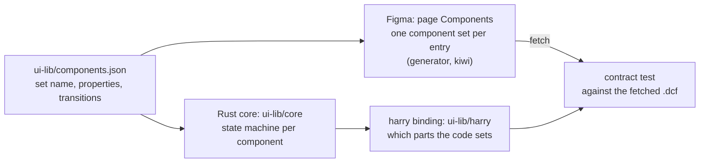
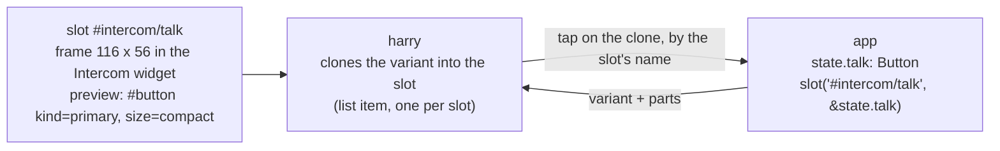
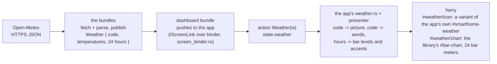

# 8. UI components: one library, four places

A control of the dashboard (a button, a toggle, the dimmer, the weather chart) is drawn once in
the Figma library and used in many places on the screen. The library lives in
`vendor/sdv-everyware/ui-lib`; one file describes every component, and four places are
generated from or checked against it.



| Place | What it holds | Example: `#button` |
|-------|---------------|--------------------|
| `components.json` | the set name, its variant properties, the transitions | kind primary/secondary/ghost, state default/disabled, size regular/compact; press 80 ms, release 160 ms |
| Figma, page Components | the look of every variant, drawn by the generator ui-lib `design/components-patch.js` | 12 variants in the frame `Library` |
| `core/src/button.rs` | gestures in, variant and events out; no drawing | `Button::on(gesture) -> Option<Clicked>`, `variant()` = `"kind=primary, state=default, size=compact"` |
| `harry/src/slot.rs` | `Slotted`: the parts the code sets on the clone | the label text, the pressed layer's opacity |

The generator and the Rust code read the same JSON, so a property added in one place is missing
in the other until both are updated, and the contract test says so.

## A slot: how a component gets onto the screen

The dashboard does not contain the component, it contains a **slot**: a frame with the app's
name (`#intercom/talk`) and a preview instance of the component inside. On the device harry
replaces the preview with a clone of the variant the app asks for and gives the clone its own
customizations (harry's list items). The same component can be on the screen many times, each
clone customized on its own.



In the app one slot is one field of the UI model and one line in the presenter:

```rust
talk: Slot = "#intercom/talk" ["SlotCustomizer"];        // ui_model.rs
model.talk = slot("#intercom/talk", &state.talk);         // presenter.rs
"#intercom/talk" => state.talk.on(gesture),               // actions.rs
```

## Variant or value

A component has two kinds of change, and the split decides how smooth the screen is:

| | Variant | Value |
|---|---|---|
| what | another drawing of the component (disabled, selected, error, a kind, a size) | a part moves or fades (thumb, fill, pressed layer, caret, an open list) |
| in Figma | a variant of the set | a meter on the part (progress bar, progress marker) or a layer whose opacity the code sets |
| in harry | rebuilds the tree and lays the screen out again (~50 ms on the RB3) | display only: the cached frame is drawn with a new value, every frame |
| in the code | `variant()` | `.meter(part, Meter)`, `.opacity(part, Meter)` in `Slotted::parts` |

So **pressed is not a variant**: it is a layer `#button/pressed` that fades in by opacity in 80 ms
and out in 160 ms. A toggle's thumb is a progress marker that travels from 0 to 100 % along the
track; the dimmer's fill is a progress bar. The curves come from the transitions in
`components.json` (`ui-lib/core/src/follow.rs`).

## As Google draws it

The library follows the components in Google's own Figma files for harry (ListTestUI.fig,
homescreen_share.fig), because harry is built for them:

- **A variant has a fixed size.** A clone in a slot is exactly the variant, nothing is resized at
  runtime. Another width is another value of a `size` property (`#button`: regular 200, compact
  116), chosen by the designer.
- **The fill is on the variant itself**, or on a layer that covers it. A rectangle drawn
  separately keeps a path baked at its Figma size.
- **A label is a box across the variant with the text centred**, not a text that hugs: a longer
  label stays centred and the width stays the design's.
- **A moving part is the marker itself.** harry moves the shape that carries the meter, not the
  children of a frame: the dimmer's thumb is a rounded rectangle, not a frame with a circle in it.

Two other ways were tried and dropped: sizing the clone at runtime (harry declares the API but
never applies it) and "Fill container" variants (the fetch writes a variant as a top-level node
with its own size). Both needed patches to harry; the library needs none for sizes.

## Sheets, forms and the keyboard

A sheet over the screen (the Wi-Fi password) is the app's drawing, not the library's, but its
behaviour is: `Overlay` (closed or open, with the open and close transitions), `Form` (input
fields, the focus, typing) and `KeyboardDock` (the screen's one keyboard, open while a field
has the focus). The app's generator draws each as a component set with the properties the
library expects (`state=closed|open`) and puts an instance of the closed variant on the
screen in a layer of its own; the code switches the variant and harry animates the change:
the parts that exist in both variants slide and fade from the old drawing to the new one.

```
#smarthome-root
  ├ ... the dashboard (auto layout column)
  ├ Wi-Fi sheet layer (absolute)   └ #wifi = #wifi-sheet      state=closed | open
  └ Keyboard layer   (absolute)    └ #osk  = #keyboard-dock   state=closed | open
                                       └ #osk/keys (slot with #keyboard)

tap on #wifi/password  →  form.on(): the field takes the focus
after every action     →  osk.follow(form.focused().is_some())  →  the dock opens, 200 ms
Done on the keyboard   →  Submitted(field)  →  the app: connect
```

The keyboard belongs to the screen, as a system keyboard: a second form on the same screen
(settings, a search) uses the same dock, and a sheet's set stays two variants. One
rule, in one line of the app, decides when the keyboard is on the screen.

## The contract test

`ui-lib/harry/src/slot.rs` has a test that loads the app's `smarthome.dcf` and, for every
component, checks that the variant the code asks for exists in the Figma set and that every part
the code sets (`#button/label`, `#slider/thumb`, `#bar-chart/bar/1` ...) is in every variant of the set.
A renamed layer, a variant drawn without a part or a property added on one side only fails the
test, before anything runs on the device.

## From data to pixels: the weather

A bundle sends information; how it looks is the app's. The UI library knows neither.



Three owners, three places:

| What | Where | Why there |
|---|---|---|
| the data (a WMO weather code, temperatures, the chance of rain) | the bundles | they know the source |
| what it means on this screen: which picture a code gets, its words, which hours count as rain, how temperatures become bar heights | the app: `src/weather.rs` and the presenter; the pictures are a component set of the app's design (`design/weather-pictures.js`) | representation is the app's |
| a bar chart: 24 bars with a level 0..100 and an accent | ui-lib: `#bar-chart`, `BarChart` | a component, used by any app for any data |

## Adding a component

The step-by-step guide is the skill `ui-lib/skills/ui-component/SKILL.md` (JSON, Figma generator,
Rust core, harry binding, app, fetch, device) with `traps.md` for what went wrong before.

## Key terms

- **Slot**: a frame on the screen, named for the app, that holds one library component.
- **Variant**: one drawing of a component set, named by its properties (`kind=primary, state=default`).
- **Meter**: a Figma plugin value on a part (progress bar, progress marker) that harry applies
  per frame without a new layout.
- **Contract test**: the host test that compares the code's names with the fetched design.
- **Overlay**: a sheet over the screen, closed or open; the app draws its set, the library
  gives the states and the transitions.
- **Form**: an overlay with input fields; a tap moves the focus, the keyboard types into the
  field in focus.
- **Keyboard dock**: the screen's one keyboard, an overlay at the bottom that opens while a
  field has the focus.

## Official documentation

- [Display Safety: the high availability renderer (HAR)](https://source.android.com/docs/automotive/sdv/display-safety)

## What's next

[Devices and dashboard](../solution/devices-and-dashboard.md): which bundle drives which tile.
