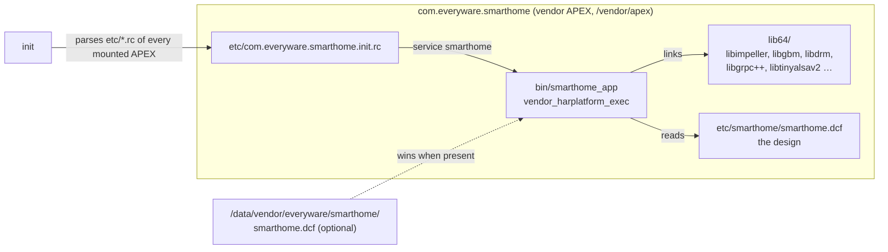
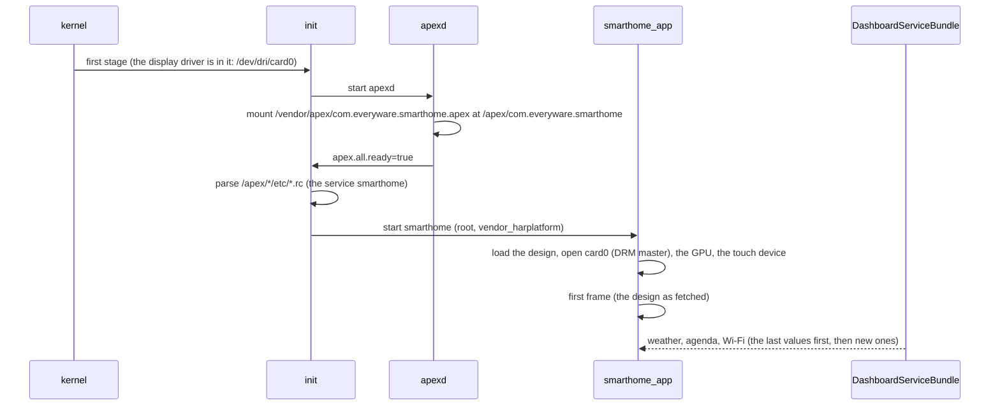
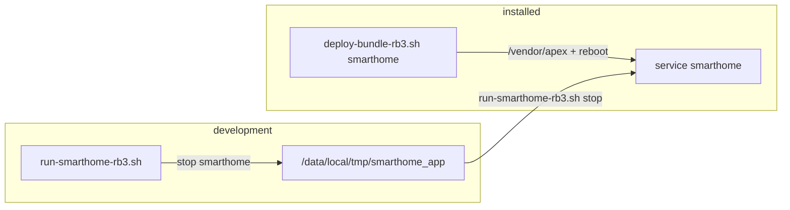

# 9. Starting the app: from power on to the first frame

The panel's screen is one process, the harry app of the device (`smarthome_app`). It is not
started by a script or by a person: init starts it when the device boots, restarts it when it
ends, and nothing else draws on the display. This page shows how, with the panel as the
example, the way HAR starts its own reference app (`harry`).

## The pieces



| Piece | Where (tree) | What it is for |
|---|---|---|
| the APEX | `packages/services/display_safety/utils/smarthome-app/apex/Android.bp` | one file with the binary, the libraries it links, the design and the init script; installed and updated as a whole |
| the init script | `apex/init.smarthome.rc` | the service `smarthome` and the trigger that starts it |
| the SELinux labels | `apex/file_contexts` | the binary in HAR's UI process domain `vendor_harplatform` |
| the product | `device/rb3/sdv_media_db845c/sdv_media_db845c.mk` | `PRODUCT_PACKAGES += com.everyware.smarthome`; HAR's own app is not in the image |
| the domain | `packages/services/display_safety/service/product/sepolicy/harplatform.te` (the board's `BoardConfig.mk` adds it to `BOARD_VENDOR_SEPOLICY_DIRS`) | what the UI process may do: DRM, GPU, input, audio, its sockets |

## The init script

```
service smarthome /apex/com.everyware.smarthome/bin/smarthome_app \
        --data-path /apex/com.everyware.smarthome/etc/smarthome \
        --override-path /data/vendor/everyware/smarthome \
        --document-id smarthome.dcf \
        --touch-size 1920x1080
    class main
    user root
    group graphics input audio
    disabled
    updatable

on property:apex.all.ready=true
    mkdir /data/vendor/everyware 0770 root graphics
    mkdir /data/vendor/everyware/smarthome 0770 root graphics
    start smarthome
```

| Line | Why |
|---|---|
| `/apex/com.everyware.smarthome/bin/smarthome_app` | the binary in the APEX; the libraries next to it in `lib64/` (the APEX's linker namespace), so the app needs no `LD_LIBRARY_PATH` |
| `--data-path …/etc/smarthome` | the design that came with the APEX |
| `--override-path /data/vendor/everyware/smarthome` | a design pushed there wins (a test of a new fetch without a new APEX) |
| `--touch-size 1920x1080` | the RB3's HDMI touch reports 0..32767; the app maps it to the display's pixels |
| `class main` | the class of the device's daemons |
| `user root` | as HAR's harry: the UI process is the display's DRM master and opens the touch device |
| `group graphics input audio` | the GPU and the display, the touch device, the sound of a tap |
| `disabled` | not started with its class: the trigger below starts it once its files exist |
| no `oneshot` | init restarts it when it ends (`restart_period`, 5 s by default); only a `critical` service makes init reboot the device after four crashes in four minutes, the panel is not one |
| `updatable` | a service an APEX may define and a newer APEX may replace (init refuses to let an APEX's script redefine a service without it) |
| `on property:apex.all.ready=true` | apexd has mounted every APEX: the binary, its libraries and its design are there |
| `mkdir /data/vendor/everyware/smarthome` | the place for a design pushed for a test |
| `start smarthome` | the service starts; the first frame follows once the design is loaded |

The trigger needs no property of its own: a product that has the APEX has the panel. HAR's APEX
starts harry on the same trigger (`service/product/harry_apex/init.display_safety.har.rc`).

## From power on to the first frame



The screen shows the design and the house's data together: the weather bundle publishes its
last values, kept from the previous start, as soon as the lifecycle manager
starts them (about 6 s), and the bridge gets them when it subscribes (`read_on_subscribe`).
The new values follow once the network is up (about 18 to 20 s on the RB3:
[bundles/weather](../../bundles/weather/README.md)).

## The libraries

An APEX gets its own linker namespace: the process sees the libraries in the APEX's `lib64/`
and, of the platform, only those the APEX declares (`requireNativeLibs` in the manifest the
build generates). The build declares what the binary links. harry's context opens EGL and GLES
at run time (`dlopen("libEGL.so")`), so the app links `libEGL` and `libGLESv2` (`shared_libs`
in its `Android.bp`, as HAR's `harry_app` does); without that the panel aborts at its first
frame with `Unable to find libEGL.so`, and init restarts it every five seconds.

```
smarthome_app ──links──► lib64/ of the APEX (libimpeller, libgbm, libdrm, libgrpc++ …)
              ──links──► libEGL.so, libGLESv2.so (platform, LLNDK, declared by the APEX)
                              └─loads──► /vendor/lib64/egl/libEGL_mesa.so (the GPU driver, :sphal)
```

## The SELinux domain

The binary is labelled `vendor_harplatform_exec` (`apex/file_contexts`), so init runs it in
`vendor_harplatform`, the domain HAR defines for its own UI process. A harry app is the same
kind of process: renderer, display, touch. The domain is a vendor domain, so the APEX is a
vendor APEX (`vendor: true`); its libraries are `vendor_harplatform_lib_file`.

| May | From |
|---|---|
| the GPU (`gpu_device`), the display (`graphics_device`) | `harplatform.te` |
| input devices, audio devices, video devices | `harplatform.te` |
| its own sockets, vendor data files | `harplatform.te` |
| be started by init (`init_daemon_domain`) | `harplatform.te` |

A product whose panel needs less (no audio, no camera) gets a domain of its own: the same file
with fewer rules, and the label in `file_contexts`.

## Other processes of the panel: the browser, the camera, the game

Three processes show in zones of the panel: each a Wayland client of the panel's socket
`har-display` in its runtime directory `/data/vendor/everyware/run` (0750 root:oem_2900, the
socket root's alone), so each runs as root. init starts them when the panel runs
(`on property:init.svc.smarthome=running`). The RB3 boots with `androidboot.init_rc`, so init reads
only the root init and its imports: device-rb3's `init.sdv_media.rc` imports the directory
`/vendor/etc/init/everyware`, where the camera's and the game's services are installed; the
browser has a root init of its own (`init.sdv_media.browser.rc`). The domains are device-rb3's
(`sepolicy/vendor`); the panel's side of each is in its `vendor_harplatform.te`.

| Process | Init service | Starts | SELinux domain | May |
|---|---|---|---|---|
| the browser (`scripts/everyware-browser.sh`: Cog in a Debian root) | `everyware_browser` (`product/everyware_browser.rc`), oneshot: the script keeps its children | with `EVERYWARE_EXPERIMENTAL_BROWSER=true` (everyware.mk) | `everyware_browser` (permissive while its rules are collected) | `/proc/net/unix`; the rest as the denials show |
| the camera (camera-app: a USB webcam in the camera tile and the full view) | `everyware_camera` (camera-app's `product/everyware_camera.rc`), root, group camera, started again when it ends | always on the RB3 (camera-app's `product/camera.mk`) | `everyware_camera` | `/dev/video*` and sysfs to find the camera; the GPU's render node; its design in `/vendor/etc/camera-app`; the panel's socket; its control socket `har-camera` (`everyware_camera_socket`), which the panel connects to; `setsched` for its decode thread; no network |
| the game (doom-app: DOOM in a dialog) | `everyware_game` (doom-app's `product/everyware_game.rc`), root, started again when it ends | with `EVERYWARE_GAME=true` (doom-app's `product/doom.mk`) | `everyware_game` | the panel's socket (its picture in wl_shm memory the panel maps); its keys' FIFO `har-game-keys` (`everyware_game_fifo`), which the panel writes; the WAD in `/vendor/etc/doom`; its data in `/data/vendor/everyware/doom` (`everyware_game_data_file`); no GPU, no network |

The camera's and the game's binaries are on the vendor partition (`/vendor/bin`), where the
board's `file_contexts` labels them; the game's WAD is in `/vendor/etc/doom`. Each ends or waits
when the panel goes away: the camera ends and init starts it again (harry's zone client does not
connect again), the game waits for the panel and reaches it again.

```bash
# WHAT: the panel's other processes, their state and their domains
adb shell 'getprop | grep -E "init.svc.(everyware_|smarthome)"; ps -AZ | grep -E "camera_app|doom_app|everyware"'
# WHAT: what SELinux refused them (the board is permissive: denials are logged, not enforced)
adb shell 'dmesg | grep avc | grep -E "everyware_(camera|game)"'
```

A clean start logs two denials of the camera and nothing else: `getattr` on `/system/etc/aconfig`
and on `/system/etc/perfetto`, the libraries' look at the platform's flag and tracing
configuration. Their types are private to the platform's policy, so the board's vendor policy
can neither allow nor silence them; the camera does not need either directory.

## Updating and developing

A product's update goes through the SDV Update Manager, with a rollback when the new version
does not start: [10. Updating the system](10-updating-the-system.md). The table is the
development's way.

| What | How | Reboot |
|---|---|---|
| a new version, installed for development | `scripts/deploy-bundle-rb3.sh smarthome` (the APEX over the image's in `/vendor/apex`, remount) | yes: apexd mounts APEXes at boot |
| a new design only | `adb push smarthome.dcf /data/vendor/everyware/smarthome/` and `adb shell restart smarthome` | no |
| back to the APEX's design | `adb shell rm /data/vendor/everyware/smarthome/smarthome.dcf` and `restart smarthome` | no |
| a development build | `scripts/run-smarthome-rb3.sh` (stops the service, runs the build from `/data/local/tmp`) | no |
| back to the installed panel | `scripts/run-smarthome-rb3.sh stop` (`start smarthome`) | no |



## Checking it

```bash
# WHAT: is the panel running, and how often did init restart it
adb shell getprop init.svc.smarthome           # running / restarting / stopped
adb shell getprop ro.boottime.smarthome         # when init started it (ns since boot)
adb shell ps -A -o PID,ETIME,LABEL,ARGS | grep smarthome
# WHAT: what it says, and what SELinux refused it
adb logcat -s smarthome-app init
adb shell dmesg | grep 'avc:.*vendor_harplatform'
# WHAT: which design it loaded
adb logcat -d -s smarthome-app | grep 'the design from'
```

## How long it takes

From the kernel's start to the panel's first frame: about 7.6 to 7.9 s on the RB3 (boot
completed at about 5.4 to 5.7 s, the panel starts at about 5.4 s and needs about 2.1 s to its
first frame). The method, the script and the runs:
[tools/boot-time](../../tools/boot-time/README.md).

## Key terms

- **APEX**: a signed file system image (`.apex`) that apexd mounts at `/apex/<name>`; it brings
  its binaries, libraries, configuration and init scripts.
- **init script (`.rc`)**: services and triggers; init reads the ones of the partitions at boot
  and the `etc/*.rc` of every APEX once it is mounted.
- **`apex.all.ready`**: the property apexd sets when every APEX is mounted.
- **DRM master**: the one process that may set the display's mode and show its frames.

Related: [2. Components](2-components.md), [5. UI](5-ui.md), [6. Security](6-security.md).
