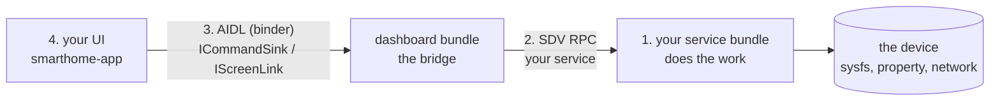

# Getting started: add a feature

This page shows how a new feature gets from a tap on the screen to the device and back. It
assumes the tree is synced and the image builds (README, "Get started").

## How the parts fit



The screen is not an SDV participant. It talks only to the dashboard bundle, over binder. The
dashboard bundle talks to every other bundle over SDV. A bundle that does the work owns it: it
is the only one that touches the device for it.

## First: what kind of feature is it?

| The feature | Example | Path |
|---|---|---|
| changes only the screen | collapse a card, switch a tab | step 4 only |
| a choice the device must remember | 24-hour clock, °F, brightness | a **setting**: a key in the System bundle, then step 4 ([below](#a-setting-is-shorter)) |
| does something now | turn a light on, scan Wi-Fi | steps 1 to 4, a **command** (RPC) |
| shows data that changes by itself | room temperature, news | steps 1 to 4, a **topic** (publish/subscribe) instead of a command |

The rest of this page is the command path: a toggle that does something on the device. For each
step there is a working example to copy: the Matter bundle for a command, the weather bundle
for a topic.

## 1. Create the service bundle

The bundle does the work. Copy `bundles/wifi` or `bundles/matter` and rename.

```
bundles/<name>/
├─ src/lib.rs        the service bundle and the implementation of your RPC service
├─ Android.bp        the library
├─ README.md
└─ apex/             APEX, test key, manifest, orchestration, permissions.textproto
```

The service is a protobuf service in the catalog, so every side gets generated code:

```protobuf
// catalog/led_service.proto
service LedService {
  rpc Set(LedSet) returns (LedResult) {}
}
message LedSet { bool on = 1; }
message LedResult { bool ok = 1; string error = 2; }
```

```
# catalog/everyware.vsidl: who serves it
service_bundle {
    name: "LedServiceBundle"
    server {
        service: "LedService"
        channel: "led"
    }
}
```

Then:
- `catalog/generated/Android.bp`: the bundle's crate and the RPC crate (copy the Matter blocks).
- `apex/permissions.textproto`: the same `server` as in the vsidl. The SDV agents check it.
- `product/everyware.mk`: `com.everyware.<name>` in `PRODUCT_PACKAGES`.
- If the bundle touches the system (a sysfs file, a system property), it needs its own SELinux
  domain (`device-rb3` sepolicy) and a line in `product/service_bundle_contexts`:
  `com.everyware.<name>.<Name>ServiceBundle u:r:<name>_service_bundle:s0`. Without that line it
  runs in the default domain, which may not touch the system.

The implementation in `src/lib.rs`, shaped like `bundles/wifi/src/lib.rs`:

```rust
// the server trait vsidlc generates: crate com_everyware_led_service_rpc, trait Interface
#[async_trait]
impl com_everyware_led_service_rpc::Interface for Led {
    async fn Set(&self, _caller: ServiceFqin, request: &LedSet) -> SdvResult<LedResult> {
        let value = if request.on { "511" } else { "0" };
        match std::fs::write("/sys/class/leds/green:indicator-1/brightness", value) {
            Ok(()) => Ok(LedResult { ok: true, ..Default::default() }),
            Err(e) => Ok(LedResult { ok: false, error: e.to_string(), ..Default::default() }),
        }
    }
}
```

## 2. Connect the dashboard bundle to it

The dashboard bundle is the client.

```
# catalog/everyware.vsidl, in DashboardServiceBundle
    client {
        service: "LedService"
        channel: "led"
    }
```

- `bundles/dashboard/apex/permissions.textproto`: the same `client`.
- `catalog/generated/Android.bp` and `bundles/dashboard/Android.bp`: the RPC crate in `rustlibs`.
- `bundles/dashboard/src/lib.rs`: a client that waits for the server, and a call per command.
  Copy `create_matter_client` and `call_matter`.

## 3. Connect it to the screen (AIDL)

The screen and the dashboard bundle talk over two binder interfaces in
`interfaces/screen/com/everyware/screen/`:

```java
// ICommandSink.aidl: the screen -> the bundle
    oneway void onLedCommand(in byte[] command);   // a com.everyware.LedSet
// IScreenLink.aidl: the bundle -> the screen
    void publishLedResult(in byte[] result);       // a com.everyware.LedResult
```

- **Add a new method at the end of the interface, never in the middle.** A method is a number
  in binder; a method in the middle shifts the others, and a panel built before it calls the
  wrong one (`UNKNOWN_TRANSACTION`).
- Then `m com.everyware.screen-update-api`: it writes the interface's API snapshot to
  `aidl_api/`, which the build compares against. Commit both.
- `bundles/dashboard/src/screen.rs`: `Sink::onLedCommand` and `publish_led_result`, like the
  Matter ones.

## 4. Write your UI

The screen is a Figma design driven by code.

- `smarthome-app/design/*-patch.js`: the control in the design, a library component in a slot
  (`controlRow('#prefs/led', 'Status LED', toggle)` in `prefs-patch.js`). Then build the design
  to the `.dcf` (`design/build.sh`, `fig-to-dcf.sh`).
- `src/ui_model.rs`: the slot, `prefs_led: Slot = "#prefs/led" ["SlotCustomizer"];`
- `src/state.rs`: the control's state, `pub led: Toggle`.
- `src/actions.rs`: the tap sends the command:

```rust
"#prefs/led" => {
    if let Some(ToggleEvent::Toggled(on)) = prefs.led.on(gesture) {
        screen_binder::send_led_command(LedSet { on, ..Default::default() });
    }
}
```

- `src/screen_binder.rs`: `send_led_command` and `publishLedResult`, like the Matter ones.
- `src/presenter.rs`: `model.prefs_led = slot("#prefs/led", &prefs.led);`

## Build and run on the board

```bash
source device/rb3/sdv_media_db845c/tools/env.sh
m com.everyware.led com.everyware.dashboard          # the two bundles
adb root && adb remount                              # after every reboot
adb push $OUT/product/apex/com.everyware.led.apex $OUT/product/apex/com.everyware.dashboard.apex /product/apex/
adb reboot
vendor/sdv-everyware/everyware/scripts/run-smarthome-rb3.sh all   # the app with its design
adb logcat -s led_bundle dashboard_bundle smarthome-app
```

A new bundle or a new SELinux domain needs the image: `m`, then `tools/flash.sh images` in
`device-rb3`.

## A setting is shorter

A choice the device must remember (24-hour clock, °F, brightness) does not need steps 1 to 3.
SDV's `user_preferences` stores it, the System bundle applies it, and the dashboard bundle
already passes every settings group to the screen.

1. `bundles/system/src/lib.rs`: the key, its default, `apply()`, and the group's version + 1.
2. Step 4 for the screen, with `prefs.change(KEY, value)` instead of a command.

The whole path, with a diagram: `bundles/system/README.md`.

## Before you open a review

- The new AIDL methods are at the end, and `aidl_api/` is updated.
- The bundle's `permissions.textproto` matches its lines in the vsidl, on both sides.
- An SELinux rule only where the bundle touches the system, and the reason in a comment.
- Every change goes on a branch: `scripts/feature.sh start <name> <repos>`, review, land
  (`AGENTS.md`, "How a change lands").
