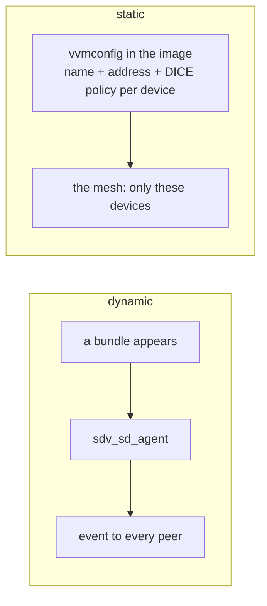

# Open points

Topics that are known but not solved yet. Each one has what is known, the options and our
proposal.

## 1. Device discovery

**Question**: can a new device join the house by itself, the way a new bundle appears on a device?

### What SDV does today

Service discovery is dynamic, device discovery is not. Read in
`system/software_defined_vehicle/middleware/service_discovery/sdv_sd_agent`:

| | How | Dynamic? |
|---|---|---|
| services | a bundle appears or disappears, `sdv_sd_agent` sends an event to every peer | yes |
| devices | the peers are listed in `vvmconfig` (`/product/etc/vvmconfig*`, CBOR, read at start): for each one its name, the address of its `sdv_sd_agent` (IPv4 and/or IPv6), its DICE policy; plus the root key and the revocation list | no |

- `mesh/manager.rs` connects only to the peers listed in the vvmconfig.
- `mesh/credentials_checker.rs` accepts a peer only if its name is in the vvmconfig, its DICE
  chain matches the policy, its boot mode is locked and verified boot is green.
- There is no mDNS, multicast or SSDP in the agent.



In a car this is on purpose: the set of computers is fixed at the factory, and a fixed list plus a
strict cryptographic check is a security feature. In a house devices come and go.

### Options

| # | Approach | How | For | Against |
|---|----------|-----|-----|---------|
| 1 | static vvmconfig, as today | adding a device = a new vvmconfig rolled out to every device | no code | every new device means reconfiguring all |
| 2 | mDNS + trust by CA | a device announces `_sdv-sd._tcp` (name and address); `sdv_sd_agent` connects by itself and accepts a peer signed by the house's CA instead of a name in a list | plug in and it appears; the same DICE check | change in `sdv_sd_agent`: there is already a `MeshConnector` abstraction, but acceptance is tied to the name in the vvmconfig |
| 3 | commissioning, as in Matter | the new device scans a QR code, the panel (hub) gives it a certificate of the house and sends the new peer list to everyone | only what you added gets in | needs our own commissioning protocol |
| 4 | Matter bridge for third-party devices | a bundle on the panel (`MatterServiceBundle`, bundles/matter): Matter does the mDNS and the commissioning, Matter devices become an SDV topic (`matter-devices`) and an RPC (`MatterService`) | real lamps and sensors from any vendor; the smart home standard | built on rs-matter (Rust, `third_party/rust`), runs on the RB3; what the screen does with any number of devices: [6](#6-matter-devices-on-the-screen) |

### Proposal

Our own SDV Media devices find each other with mDNS and are accepted by the house's signature
instead of a fixed list (option 2); a new device gets that signature once, when it is added to the
house (option 3). Third-party smart home devices come in through a Matter bridge (option 4). Until
option 2 exists, the peers are listed in the vvmconfig (option 1).

Related: [4. Communication](../concepts/4-communication.md), [status](status.md).

## 2. Message schemas in the APEX (`vsidl-config.binpb`)

`vsidlc --apex` can put a file with the protobuf schemas of a bundle's messages into its APEX
(`vsidl_schemas_path` in the bundle manifest, read by agents that use `libsdv_config_provider`:
diagnostics, the SOME/IP bridge). With it another agent can read what a message carries
(`Weather { temperature_c: double, ... }`) without the bundle's code; without it only the bundles
of the catalog understand the topic, which is all the dashboard needs today. HAR's own bundle
APEX ships none either.

TODO: add it when a reader appears: the McpBundle that offers the house's topics to an AI agent
([AI agents](../solution/ai-agents.md): "vsidl as the source") or a SOME/IP device. One line in
`catalog/generated/Android.bp` (`--apex` in the vsidlc genrule) and a `prebuilt_etc` per APEX;
`skills/service-bundle/SKILL.md` describes the generated layout.

Related: [3. Service bundles](../concepts/3-service-bundles.md), [status](status.md).

## 3. Orchestration by power state

The [orchestrator agent](https://source.android.com/docs/automotive/sdv/core-areas/orchestrator)
starts and stops bundles by **groups** and by the device's power state;
`vsidlc --apex` generates that for a package (`vm/<package>/vm_<package>_orch_config.textproto`:
a group `auto_start` that is `started` on `ON`, `POWER_OFF_EXIT`, `SUSPEND_TO_RAM_EXIT` and
`created` on `SUSPEND_TO_RAM_ENTER`, `WAIT_FOR_FINISH`; every bundle's `orchestrator.textproto`
puts its instance into a group). Our bundles use the plain form, one instance always `started`,
which is right for a panel on mains power.

SDV Media is the OS of embedded devices in general, not only of the panel: a battery device, a
sensor or a device that suspends has power states, and then the bundles of the device must
follow them (the radio bundle stops on suspend, the sensor bundle keeps its last value, the
screen's bridge restarts on resume and resends). The generated layout is the way to do it.

TODO: when the second device type arrives, move the bundles to groups and a per-device
orchestration config (`vsidlc --apex` output, `skills/service-bundle/SKILL.md`), and define per
bundle what it does on suspend and resume. Check how the orchestrator sees the power state on a
device without a car's VHAL (`system/software_defined_vehicle/orchestration`).

Related: [3. Service bundles](../concepts/3-service-bundles.md), [1. The OS](../concepts/1-the-os.md).

## 4. The screen is one process

harry renders everything in one process: the app (state, presenter, the UI library's
customizers) and the renderer (the looper that owns the display through DRM/KMS and EGL) share
it. A panic in a presenter, a bug in a customizer, a fault in a driver call: the whole UI is
gone until the process is back. The bundles are not affected (their state lives in their own
processes, the bridge resends the last values when the screen listens again,
[harry-app-anatomy](../../../../../../packages/services/display_safety/utils/smarthome-app/docs/harry-app-anatomy.md)),
so recovery is a restart, but the screen is black for its duration and every part of the UI
shares the fate of every other part.

```
today                                     wanted
┌ harry process ──────────────────┐       ┌ master: owns the display ─┐   ┌ client A: dashboard ┐
│ app + UI library + renderer      │       │ Figma document = zones    │◄──┤ own process          │
│ DRM/KMS, EGL, one display        │       │ composites the clients'   │   └──────────────────────┘
│ one fault = no UI                │       │ buffers into zone nodes   │◄──┌ client B: camera ... ┐
└──────────────────────────────────┘       └───────────────────────────┘   └──────────────────────┘
```

Ideas:

| # | Approach | How | Status |
|---|----------|-----|--------|
| 1 | **master harry as a compositor** of other harry processes | the master owns the display and a Figma document whose nodes are **zones**; a client harry process renders its own document into a buffer and hands it over by Wayland (`har_zone` protocol binds a surface to a node tag; dmabuf zero-copy on real hardware, `wl_shm` on Cuttlefish); the master shows it through the external-image path, so a crashed client leaves a hole or a placeholder, not a black screen | prototype in the tree (`framework/graphics/har-wayland-{client,server}`, `har-gl-context` wayland backends): stage 1 verified on Cuttlefish 2026-10-25 (master + client in a zone, kill and restart of the client fine). Open: master CPU (~120 %), init socket and sepolicy, zone-sized client documents, dmabuf on the RB3. 2026-11-07 on the RB3: dmabuf between processes, touch in zones, and a browser (Cog/WPE, GPU) in the camera tile through standard xdg-shell: [browser.md](browser.md) |
| 2 | **a light display broker with DRM leases** | a small daemon (`har_display_broker`, the pattern of AGL's `drm-lease-manager`) starts early, opens `card0`, becomes DRM master, does the first mode set (a splash or black) and never draws again; every harry process asks it for a named display over a UNIX socket and gets a **lease** fd (connector + CRTC + planes) and commits its own buffers directly. A crashed harry loses only its pipeline; the broker is tiny and never changes, so it is the one process that must not fail. No compositor, no copy on the frame path; the limit is the display controller: one pipeline per process, the DPU blends the planes, no Figma layout across processes | analysed (`har-drm-lease-analysis`, options A to E: C is this one; B, harry itself as the lessor, is the cheap wrong step: the biggest process stays the critical one). Not built. Needs: the broker, its SELinux domain and socket, harry opening the display from a lease fd; the RB3's DPU has the planes, Cuttlefish's virtio-gpu connectors have no scanout behind them |
| 3 | **app and renderer in two processes** inside harry | the reducer, presenter and customizers in one process, the looper with DRM/EGL in another, the display list crossing an IPC; an app fault leaves the last frame on the screen | not started; needs a change in harry's looper API, upstream question |
| 4 | one process, fast restart and placeholders | a watchdog restarts the process; HAR's own design shows placeholders when a source stops its heartbeat | what we have, minus the measurement and the placeholder design |

Proposal: measure the restart first (time from the crash to the first frame, with the bridge
resending the values). Then option 1 for the second UI process, where the split pays: the
camera or video tile, a third-party application in a zone (Chromium was the planned first
foreign client), so a fault there never takes the dashboard. Option 2 is the right split when the regions are
whole pipelines (a second display, a status bar on its own plane) and no composition is needed;
the two can be combined: the broker hands the master a lease, the master composites its clients.

Related: [5. UI](../concepts/5-ui.md), [2. Components](../concepts/2-components.md).

## 5. Letter spacing in text

**Question**: can the screen draw a text with the letter spacing of the design?

### What is known

harry draws text through Impeller (Flutter's renderer, the prebuilt `libimpeller.so` in
`packages/services/display_safety/prebuilts`). harry reads the letter spacing of a Figma text
into its style (`squoosh` `TextStyle.letter_spacing`, `impeller-renderer/src/renderer/text.rs`),
but Impeller's C API has no setter for it: its paragraph style takes the font family, size,
weight and style, the line height, the alignment, the direction, the decoration, the locale,
the maximum lines and the ellipsis. The spacing is dropped when the text is laid out, and when
it is measured.

```
Figma: "07:30" IBM Plex Mono 80 px, spacing -5.5   5 x 48 - 27.5 = 212 px  fits its 218 px box
panel: the same text, spacing 0                     5 x 48        = 240 px  wraps after "07:3"
```

What it means for a design: a text whose spacing is not 0 has another width on the panel than in
Figma. A negative spacing makes it wider and, in a box sized by Figma, wraps it; a positive one
(the date's 1.8 px) makes it narrower.

### Options

| # | Approach | How | Status |
|---|----------|-----|--------|
| 1 | design with spacing 0 where it matters | the boxes sized for the font's own advance; Figma shows what the panel shows | done for the clock (design v32) |
| 2 | letter spacing in Impeller | a setter in Impeller's C API (`ImpellerParagraphStyleSetLetterSpacing`, Skia's paragraph has the property), a rebuild of the prebuilt `libimpeller.so`, harry passing the value | not started; outside the tree, a question for the Flutter engine and for HAR upstream |
| 3 | harry places the glyphs itself | one run per character, each moved by the spacing | not started; harry's own text layout, a workaround for one property |

Proposal: 1 now, and a check in the design generator that flags texts with a spacing other
than 0; 2 as the real fix, asked upstream.

Related: [5. UI](../concepts/5-ui.md).

## 6. Matter devices on the screen

**Question**: how does a device the house adds show up on the screen, and how is it added?

### What is known

- `MatterServiceBundle` takes any device: it commissions every code of its list or of an RPC
  `Pair`, reads every endpoint's device type and the clusters it knows (Thermostat, Relative
  Humidity, On/Off, Level Control, Fan Control, Basic Information, General Diagnostics) and
  publishes all of them as one `MatterDevices` message (up to 8 nodes of 8 endpoints, the
  catalog's sizes).
- The screen has four fixed tiles. The app binds each to the **first** endpoint of its device
  type (smarthome-app `devices.rs`): Home climate 0x0301, Entryway 0x0100, Bedroom 0x0101,
  Office fan 0x002B. A second device of a type, or a device of a type without a tile (a lock,
  blinds, a sensor), is in the topic and not on the screen.
- The codes to commission are `bundles/matter/apex/pairing.txt`, in the APEX: a new device means
  a rebuilt APEX. `MatterService.Pair(code)` commissions without one, but nothing on the screen
  calls it yet.
- A cluster the bundle does not read (Door Lock, Window Covering, Occupancy, Boolean State,
  Color Control) needs: the cluster in `third_party/rust/clusters.txt`, its fields in
  `catalog/matter.proto`, reading them in `client/src/node.rs`, its commands in
  `matter_service.proto` and `node.rs`; then a tile for it.

```
code ──► bundle: mDNS, PASE, CASE, node id ──► reads it ──► matter-devices ──► bridge ──► app
                                                                                         └─► a tile? today: the first of its type only
```

### Options

| # | Option | How | Pros | Cons |
|---|---|---|---|---|
| 1 | tiles from the data | one tile per endpoint, a template per device type (thermostat, light, dimmable light, fan, ...), laid out by the screen (a grid or a scrolling list, the Rooms tab of the design) | every device of a known type appears by itself once paired | a design: a tile template per type and the layout for N tiles; a list or grid of tiles in ui-lib |
| 2 | bindings in a configuration | `node · endpoint` to tile instead of the first of a type | small; explicit which device is where | still four tiles; a configuration to keep |
| 3 | four tiles as today | nothing | nothing to do | a second device of a type is not shown |
| A | adding a device from the screen | an "Add device" sheet: the pairing code typed or the QR code scanned, then `MatterService.Pair` | as Apple Home and Google Home; no rebuild | a form and a QR path; the camera |
| B | the list of codes in the bundle's directory | `pairing.txt` in `/data/service_bundle_data/...` instead of the APEX | no rebuild | `adb push`, not a product path |

### Proposal

Tiles from the data (option 1) on the Rooms tab and an "Add device" sheet (option A), the
design first (the tile templates per type and the layout); `pairing.txt` stays the factory list
of the demo. New clusters one at a time as devices need them. Until then the four tiles show the
first device of their type (option 3).

Related: [bundles/matter](../../bundles/matter/README.md), [devices and dashboard](../solution/devices-and-dashboard.md).

