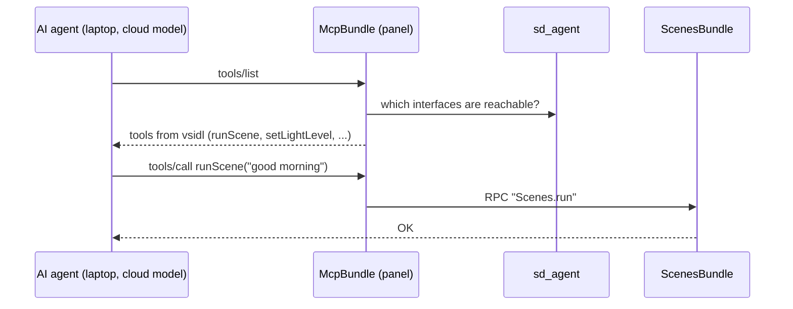
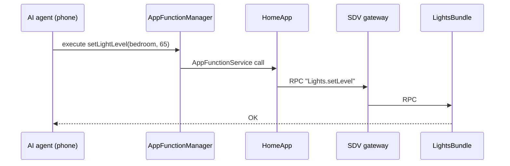
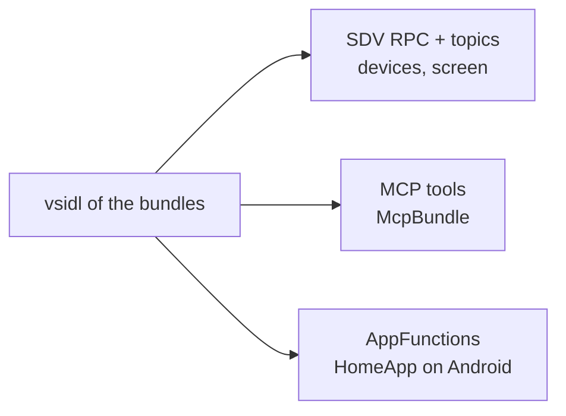

# AI agents: MCP and AppFunctions

The functions of the house are bundle RPCs and topics. An AI agent can use the same functions;
there are two ways in.

## MCP (first)

McpBundle on the panel is an MCP server written as a service bundle, so it runs without the Java
framework. The tools it offers are built from the vsidl interfaces of the bundles that discovery
knows; calling a tool becomes an SDV RPC. It is an ordinary bundle with its own policy.

The agent runs on the laptop and reaches McpBundle over the local network; only the laptop talks
to the cloud.

## AppFunctions (later)

AppFunctions belong to the Android framework: `AppFunctionManagerService` runs in system_server
(`frameworks/base/services/appfunctions/`). SDV Media has no framework, so they live on an Android
phone or tablet: HomeApp there is an SDV gateway client that declares AppFunctions
(`setLightLevel`, `runScene`, ...) and turns each call into an SDV RPC.

## One source of truth: vsidl

| | Bundles | MCP | AppFunctions |
|---|---|---|---|
| caller | screen, other bundles | any LLM agent | agent on an Android phone |
| runs on | any SDV Media device | SDV Media (McpBundle) | Android with the framework |
| live updates | topics | partly (notifications) | no |
| access control | bundle policy, device identity | McpBundle's policy | Android permissions + gateway policy |

## What's next

[Decisions](../project/decisions.md) and [status](../project/status.md).
