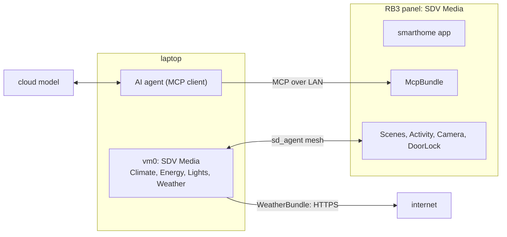

# Devices and dashboard

How the concepts are used in a smart home: which devices, which bundles, and how the
dashboard maps onto them.

## Devices

| Device | Hardware | Bundles | Screen |
|--------|-----------------|---------|--------|
| Panel | Qualcomm RB3, HDMI 1920x1080 with touch | Scenes, Activity, Camera, DoorLock, Mcp | smarthome app (harry) |
| Climate / energy unit | Cuttlefish SDV Media on the laptop (vm0) | Climate, Energy, Lights, Weather | none |
| Phone or tablet (later) | Android with the framework | HomeApp (SDV gateway client) | Android app |

The bundles can start all on the panel; moving one to another device does not change the screen
([4. Communication](../concepts/4-communication.md)).

## Dashboard, tile by tile

Design: `assets/dashboard-design-v1.png`, Figma file "Smart HOme ui" (its key
in the local `scripts/figma-key`), root `#smarthome-root`. The sheets are the library's `#sheet` (a dialog or a panel at an edge)
with a content component swapped in: the Wi-Fi sheet `#wifi` (`#wifi-content`, keyboard-patch.js),
the device sheet `#device` (`#device-content`, sheet-patch.js), the panel `#panel`
(`#panel-content`, panel-patch.js); the keyboard dock `#osk` (set `#keyboard-dock`, the library's
`#keyboard` in its slot) is its own set; each in an absolute layer over the dashboard.

| Tile | Bundle | Topics (subscribe) | RPC |
|------|--------|--------------------|-----|
| Living room camera, LIVE | Camera | `camera motion` | `expand camera` |
| Entryway lights toggle | Lights | `light state` | `setLight(on/off)` |
| Bedroom lights slider | Lights | `light level` | `setLevel(%)` |
| Office fan Low / Med / High | Climate | `fan speed` | `setFanSpeed` |
| Home climate 22°, humidity | Climate | `room temperature`, `humidity` | `setTargetTemp` |
| Energy, chart | Energy | `power now`, `power history` | |
| Front door | DoorLock | `lock state` | `lock`, `unlock` |
| Wi-Fi indicator, Wi-Fi sheet | Wi-Fi (`bundles/wifi`) | `wifi-networks`, `wifi-state` | `WifiService`: `Scan`, `Connect`, `Forget`, `Disconnect` |
| Outdoor 18° · Partly cloudy | Weather | `weather` | |
| Agenda (right column) | Calendar (`bundles/calendar`) | `agenda` | `CalendarService`: `Respond`, `Delete` (with write access) |
| Clock | system | | |

A scene shows the architecture best: "Good morning" calls Scenes, Scenes calls Lights and
Climate (on the other device), every tile updates from its own topic and the event appears in
Recent activity. The screen never wires one tile to another.

## Where the device data comes from

| Option | What | For | Against |
|--------|------|-----|---------|
| a | mock: the bundles generate the data themselves | works today, no network in the room | not real devices |
| b | MQTT or Home Assistant over the network | a real lamp switches | needs a network on the device and a broker |
| c | Zigbee USB stick, zigbee2mqtt in a glibc layer | a real local hub, no cloud | stick, glibc chroot, longest path |

## What's next

[AI agents](ai-agents.md): how an AI agent uses the same functions.

## Wi-Fi

The Wi-Fi of the panel is a service bundle of its own, `bundles/wifi` (APEX `com.everyware.wifi`):
it talks to wpa_supplicant over its control interface, publishes the networks around and the
state of the connection (`wifi-networks`, `wifi-state`) and serves the SDV RPC `WifiService`
(scan, connect, forget, disconnect, each answered), which the dashboard bundle calls for the
screen. The sheet on the screen shows what the bundle
publishes and asks for scans and connections; it never touches the Wi-Fi stack. Why it is
built this way, and what its security rests on (its own SELinux domain, the abstract control
socket, the authorization policy of the service, where the password goes):
`bundles/wifi/README.md`.
