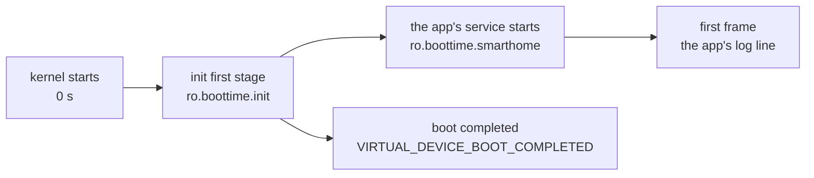

# Boot time to the first frame

How long a device takes from power on to the first frame of its app, measured the way Google
measures SDV (its boot time test) and HAR (its reference app waits for the first frame of its
document). `measure-boot.sh` reboots the device N times and prints the milestones of each boot.

```bash
# WHAT: three measured reboots of the RB3
# WHY: after a change of the image, the kernel, the app or the bundles
# WARNING: reboots the device three times
./vendor/sdv-everyware/everyware/tools/boot-time/measure-boot.sh 3
```

## What is measured



| Milestone | Source | Why this one |
|---|---|---|
| init | `ro.boottime.init` (ns since the kernel started) | Google's start: the SDV boot test counts from `init first stage started!`, not from the kernel |
| the app's service starts | `ro.boottime.<service>` (init sets it when it starts the service) | the moment the app can start working |
| boot completed | `VIRTUAL_DEVICE_BOOT_COMPLETED` in the kernel log (logcat's kernel buffer) | Google's stop for the SDV boot test (`platform_testing/libraries/sdv/sdv_catbox/res/config/sdv-performance-boot-time-test.xml`) |
| first frame | the app's line `first frame of '<doc>' at <s> s since boot` | the picture on the screen: what Google's 1 to 2 s for the cluster are about |

The first frame is the performance monitor's (har-monitoring): the reducer tells it the
document, the renderer reports every frame, and `wait_for_first_frame(document)` returns at
the first one. HAR's reference app does exactly this before it shows its next document
(`framework/harry/src/splash.rs`). The panel waits for it the same way and logs the time from
`CLOCK_BOOTTIME`, the clock of `ro.boottime.*` (the kernel log's clock differs from it only
after a suspend, which a boot does not have)
(`utils/smarthome-app/src/main.rs`, `clock.rs`).

Not measured: the bootloader before the kernel (about 15 s on the RB3 from a reset, its own
firmware), and the bundles' first data on the screen (network, DHCP, the first fetch).

## Why the log's own time stamps are not used

| Trap | What happens | What the script does |
|---|---|---|
| the clock moves during the boot | the board has no RTC: the wall clock starts at 1970 and chrony sets it to the real time a few seconds into the boot, sometimes in two steps. logcat stores wall-clock stamps; `logcat -v monotonic` then gives negative numbers for every line | the app writes the time since boot into its own line; the boot marker is read only while the clock is still at 1970, when its stamp equals the time since boot (checked: init's `starting service` line and `ro.boottime.<service>` agree to about 10 to 15 ms) |
| the kernel's buffer is small | `dmesg` has dropped the early lines a minute after the boot | the marker is read from logcat's kernel buffer |
| the first run after an install is slower | apexd activates a new APEX for the first time | the first run is listed, the average uses all runs; repeat with more runs if it matters |

## Results

RB3 (SDA845), `sdv_media_db845c-trunk_staging-userdebug`, no Java framework, the panel's APEX
`com.everyware.smarthome` started by init (docs/concepts/9-starting-the-app.md), seconds since
the kernel started.

2026-11-06, the panel with its design loaded in parallel with the display start (`main.rs`:
the document is requested before `create_looper`) and its input opened on its own thread
(evdev with hotplug, `patches/0006`):

| Run | init | the panel starts | boot completed | **first frame** | first frame from init |
|---|---|---|---|---|---|
| 1 | 0.55 | 5.55 | 5.50 | **7.68** | 7.13 |
| 2 | 0.56 | 6.19 | 6.15 | **8.41** | 7.85 |
| 3 | 0.56 | 5.38 | 5.31 | **7.63** | 7.07 |
| **average** | 0.56 | 5.71 | 5.65 | **7.91** | 7.35 |

From the service's start to the first frame: about 2.1 to 2.2 s (2.6 s before). The spread
between runs is in the time init starts the service (5.4 or 6.2 s), not in the panel.

Before that change, the same day:

| Run | init | the panel starts | boot completed | **first frame** | first frame from init |
|---|---|---|---|---|---|
| 1 (after the install) | 0.56 | 6.29 | 6.21 | **8.91** | 8.35 |
| 2 | 0.55 | 5.51 | 5.43 | **8.17** | 7.62 |
| 3 | 0.56 | 5.54 | 5.48 | **8.20** | 7.64 |
| **average** | 0.56 | 5.78 | 5.71 | **8.43** | 7.87 |

2026-10-30, HAR's own harry on the same board, for comparison (its splash's first frame;
measured the same way, three boots):

| | boot completed | the app starts | first frame |
|---|---|---|---|
| average of 3 | 6.47 | 6.63 | 8.75 |

```
kernel ─0.56─► init ─────5.0─────► panel starts (5.5) ──────2.6──────► first frame (8.2)
                     └──────────► boot completed (5.4)
```

Where the 2.6 s went (a trace of the service's start, 2026-11-06): the shaders compiled at every
start (no shader cache on disk), the display's mode set at boot, the design loaded only after the
display and the GPU were up, the EDID read through the LT9611 bridge. The design now loads in
parallel; the shader cache and the display start are the next steps.

## The script

`measure-boot.sh [runs]`; `SERIAL` (default the RB3's), `SERVICE` (default `smarthome`), `TAG`
(default `smarthome-app`). Output is CSV with `;`, one line per run and the average; `?` when a
value was not found (the app's line missing, or the clock already moved before the marker).
